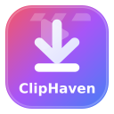

<div align="center">
 
#  ClipHaven

**Catch, keep, and enjoy your clips — locally, safely, and effortlessly.**


[](https://github.com/AsadullahAlMunib/ClipHaven/releases/tag/v3.1.0)


[](https://github.com/AsadullahAlMunib)
[](LICENSE)

[✨ Features](#-key-features) • [⚡ Quick Downloads](#-quick-downloads) • [🚀 Getting Started](#-getting-started) • [📦 Releases](https://github.com/AsadullahAlMunib/ClipHaven/releases) • [👨‍💻 Developer](#-developer)

ClipHaven is a modern, high-speed, 100% local video and audio downloader developed by [**Md Asadullah Al Munib**](https://github.com/AsadullahAlMunib) and powered by [`yt-dlp`](https://github.com/yt-dlp/yt-dlp). Available across **Windows, macOS, Linux (`x64` & `ARM64`), and Android (`64-bit` & `32-bit`)**, it runs privately on your device (`127.0.0.1:8765`) — **no ads, no tracking, no external server relays, and zero telemetry**.
</div>


## ⚡ Quick Downloads

<details open>
  <summary><strong>📥 Click here to choose &amp; download ClipHaven for your device (Dropdown Menu)</strong></summary>
  <br />

  * **🪟 Windows:**
    * ⭐ [**`ClipHaven-Windows-All.zip`**](https://github.com/AsadullahAlMunib/ClipHaven/releases/download/v3.1.0/ClipHaven-Windows-All.zip) — *Full Windows Bundle with `FFmpeg` & all dependencies included (Recommended)*
    * 📦 [**`ClipHaven-Windows.exe`**](https://github.com/AsadullahAlMunib/ClipHaven/releases/download/v3.1.0/ClipHaven-Windows.exe) — *Standalone single-file portable Windows executable*
  * **🐧 Linux (x64 &amp; ARM64):**
    * ⭐ [**`ClipHaven-Linux-x64-All.zip`**](https://github.com/AsadullahAlMunib/ClipHaven/releases/download/v3.1.0/ClipHaven-Linux-x64-All.zip) — *Full Linux x64 Bundle with `FFmpeg` & all dependencies included*
    * 📦 [**`ClipHaven-Linux-x64`**](https://github.com/AsadullahAlMunib/ClipHaven/releases/download/v3.1.0/ClipHaven-Linux-x64) — *Standalone single-file Linux x64 binary*
    * ⭐ [**`ClipHaven-Linux-ARM64-All.zip`**](https://github.com/AsadullahAlMunib/ClipHaven/releases/download/v3.1.0/ClipHaven-Linux-ARM64-All.zip) — *Full Linux ARM64 Bundle with `FFmpeg` & all dependencies included*
    * 📦 [**`ClipHaven-Linux-ARM64`**](https://github.com/AsadullahAlMunib/ClipHaven/releases/download/v3.1.0/ClipHaven-Linux-ARM64) — *Standalone single-file Linux ARM64 binary*
  * **🍎 macOS:**
    * ⭐ [**`ClipHaven-macOS-All.zip`**](https://github.com/AsadullahAlMunib/ClipHaven/releases/download/v3.1.0/ClipHaven-macOS-All.zip) — *Full macOS Bundle with `FFmpeg` & all dependencies included*
    * 📦 [**`ClipHaven-macOS`**](https://github.com/AsadullahAlMunib/ClipHaven/releases/download/v3.1.0/ClipHaven-macOS) — *Standalone single-file macOS binary*
  * **🤖 Android (64-bit &amp; 32-bit):**
    * ⭐ [**`ClipHaven-Android-64bit.apk`**](https://github.com/AsadullahAlMunib/ClipHaven/releases/download/v3.1.0/ClipHaven-Android-64bit.apk) — *For modern 64-bit Android phones (`arm64-v8a`, Recommended)*
    * 📱 [**`ClipHaven-Android-32bit.apk`**](https://github.com/AsadullahAlMunib/ClipHaven/releases/download/v3.1.0/ClipHaven-Android-32bit.apk) — *For older 32-bit Android phones &amp; TV boxes (`armeabi-v7a`)*
  * **⚡ Source Code + Launcher (`.bat`):**
    * 🛠️ [**`ClipHaven-Source-Bat.zip`**](https://github.com/AsadullahAlMunib/ClipHaven/releases/download/v3.1.0/ClipHaven-Source-Bat.zip) — *Lightweight source bundle with one-click `setup-and-run.bat`*
</details>

<br />

| Platform | All-in-One Bundle (`-All.zip`) ⭐ | Standalone Single App |
| :--- | :--- | :--- |
| **🪟 Windows** | [⬇️ `ClipHaven-Windows-All.zip`](https://github.com/AsadullahAlMunib/ClipHaven/releases/download/v3.1.0/ClipHaven-Windows-All.zip) | [⬇️ `ClipHaven-Windows.exe`](https://github.com/AsadullahAlMunib/ClipHaven/releases/download/v3.1.0/ClipHaven-Windows.exe) |
| **🍎 macOS** | [⬇️ `ClipHaven-macOS-All.zip`](https://github.com/AsadullahAlMunib/ClipHaven/releases/download/v3.1.0/ClipHaven-macOS-All.zip) | [⬇️ `ClipHaven-macOS`](https://github.com/AsadullahAlMunib/ClipHaven/releases/download/v3.1.0/ClipHaven-macOS) |
| **🐧 Linux (x64)** | [⬇️ `ClipHaven-Linux-x64-All.zip`](https://github.com/AsadullahAlMunib/ClipHaven/releases/download/v3.1.0/ClipHaven-Linux-x64-All.zip) | [⬇️ `ClipHaven-Linux-x64`](https://github.com/AsadullahAlMunib/ClipHaven/releases/download/v3.1.0/ClipHaven-Linux-x64) |
| **🐧 Linux (ARM64)** | [⬇️ `ClipHaven-Linux-ARM64-All.zip`](https://github.com/AsadullahAlMunib/ClipHaven/releases/download/v3.1.0/ClipHaven-Linux-ARM64-All.zip) | [⬇️ `ClipHaven-Linux-ARM64`](https://github.com/AsadullahAlMunib/ClipHaven/releases/download/v3.1.0/ClipHaven-Linux-ARM64) |
| **🤖 Android (64-bit)** | *(Self-contained inside `.apk`)* | [⬇️ `ClipHaven-Android-64bit.apk`](https://github.com/AsadullahAlMunib/ClipHaven/releases/download/v3.1.0/ClipHaven-Android-64bit.apk) *(Recommended)* |
| **🤖 Android (32-bit)** | *(Self-contained inside `.apk`)* | [⬇️ `ClipHaven-Android-32bit.apk`](https://github.com/AsadullahAlMunib/ClipHaven/releases/download/v3.1.0/ClipHaven-Android-32bit.apk) |
| **⚡ Source + `.bat`** | [⬇️ `ClipHaven-Source-Bat.zip`](https://github.com/AsadullahAlMunib/ClipHaven/releases/download/v3.1.0/ClipHaven-Source-Bat.zip) | [📦 All Releases](https://github.com/AsadullahAlMunib/ClipHaven/releases/latest) |


## ✨ Key Features

### 💻 Multi-Platform Ready
* **Desktop (`-All.zip` & Standalone Binaries):** Full pre-packaged bundles and portable single-file apps for **Windows, macOS, Linux x64, and Linux ARM64** with `FFmpeg` pre-included.
* **Android (`ClipHaven-Android-64bit.apk` & `ClipHaven-Android-32bit.apk`):** Lightweight, architecture-specific `.apk` builds (~35 MB)—Python, `yt-dlp`, and `FFmpeg` unpack and run inside the app's private internal storage with zero external setup, saving directly to `Downloads/ClipHaven`.
* **Source Launcher (`setup-and-run.bat`):** Creates an isolated `.venv`, installs/updates `yt-dlp` and `imageio-ffmpeg`, and launches the dashboard.

### 🌐 Wide Multi-Platform Extraction
Cleanly extracts video and audio from popular media platforms:
* **YouTube:** Full Videos, Shorts, and complete Playlists
* **Meta:** Facebook Videos & Reels, Instagram Reels, Posts & Threads (`threads.net` & `threads.com`)
* **Others:** TikTok, X / Twitter (including `t.co` share links), Reddit, Vimeo, Dailymotion, Twitch, Pinterest (`pin.it`), and SoundCloud (`snd.sc`)

### 🎯 Precision Tools & Media Options
* **📁 Native Folder Picker (`Browse`):** Pick your download folder using your OS's native folder selection dialog or type any path directly.
* **✂️ Video Trimming & Clip Cutter with Live Progress:** Download specific time ranges (`Start Time` to `End Time` in `MM:SS` or `HH:MM:SS`) with real-time FFmpeg percentage (`%`), encoding speed, and remaining `ETA`.
* **📑 Playlist Downloads:** Download entire video playlists in batch with visual badge (`📑 3/15 • 2 done • 12 left`) showing which playlist video is downloading, how many are finished, and how many remain.
* **💬 Multi-Language Subtitles (CC):** Automatically detects and embeds English (`en`, `en-orig`) and Bangla (`bn`) subtitles converted to `SRT` without triggering rate limits.
* **🖼️ Embed Cover Art / Thumbnail:** Embeds video thumbnails as permanent cover art into `MP4`, `MKV`, `MP3`, and `M4A` files.
* **⚡ Multiple Formats & 4K Quality:**
  * **Video Formats:** `MP4` *(Recommended)*, `MKV`, `WEBM`
  * **Audio Formats:** `MP3`, `M4A`, `WAV`
  * **Resolutions:** `Best Available`, `4K (2160p)`, `2K (1440p)`, `1080p`, `720p`, `480p`, `360p`
* **📊 Real-Time Feedback:** Live download speed counters (`MB/s`), accurate remaining time (`ETA`), percentage progress bars, and post-download directory navigation (`📂 Open Folder`).


## 🚀 Getting Started

### Method 1: All-in-One Bundles (`-All.zip` — ⭐ Recommended for Desktop)
1. Download `ClipHaven-Windows-All.zip`, `ClipHaven-macOS-All.zip`, `ClipHaven-Linux-x64-All.zip`, or `ClipHaven-Linux-ARM64-All.zip` from [Releases](https://github.com/AsadullahAlMunib/ClipHaven/releases/latest).
2. Extract the archive and launch **`ClipHaven`** (`ClipHaven.exe` on Windows). Your browser will open `http://127.0.0.1:8765/`.

### Method 2: Android App (`ClipHaven-Android-64bit.apk` / `ClipHaven-Android-32bit.apk`)
1. Download [`ClipHaven-Android-64bit.apk`](https://github.com/AsadullahAlMunib/ClipHaven/releases/download/v3.1.0/ClipHaven-Android-64bit.apk) *(for modern 64-bit phones)* or [`ClipHaven-Android-32bit.apk`](https://github.com/AsadullahAlMunib/ClipHaven/releases/download/v3.1.0/ClipHaven-Android-32bit.apk) *(for older 32-bit devices)* and install it.
2. Open **ClipHaven** (or share any video link directly to ClipHaven from YouTube, Facebook, Instagram, or TikTok).

### Method 3: One-Click Script (`setup-and-run.bat`)
1. Ensure **Python 3.10+** is installed with **"Add Python to PATH"** enabled.
2. Download and extract [`ClipHaven-Source-Bat.zip`](https://github.com/AsadullahAlMunib/ClipHaven/releases/download/v3.1.0/ClipHaven-Source-Bat.zip) (or clone the repository):
   ```bash
   git clone https://github.com/AsadullahAlMunib/ClipHaven.git
   cd ClipHaven
   ```
3. Double-click **`setup-and-run.bat`**. The script manages virtual environment creation, installs `yt-dlp` and portable `FFmpeg` (`imageio-ffmpeg`), and opens the dashboard automatically.

### Method 4: Developer Setup (macOS / Linux / Windows)
```bash
# 1. Create and activate a virtual environment
python3 -m venv .venv
source .venv/bin/activate       # On Windows: .venv\Scripts\activate

# 2. Install dependencies (includes yt-dlp, imageio-ffmpeg, and mutagen)
pip install --upgrade pip
pip install -r requirements.txt pytest

# 3. Launch server
python server.py

# 4. (Optional) Run tests locally
pytest -v
```


## 📂 Project Structure

```
ClipHaven/
├── .github/
│   ├── dependabot.yml            # Dependency updater configuration
│   └── workflows/
│       ├── ci.yml                # Multi-platform CI testing pipeline
│       └── release.yml           # Automated 11-asset builder (Windows, macOS, Linux x64/ARM64, Android 64/32-bit & Source)
├── android/                      # Self-contained Android APK project (WebView + youtubedl-android)
├── scripts/
│   └── generate_icons.py         # Pixel-faithful logo.svg -> logo.ico & Android mipmap generator
├── tests/
│   └── test_server.py            # Unit and API integration test suite
├── logo.svg                      # Vector application logo and favicon
├── index.html                    # Clean, responsive web UI
├── style.css                     # Dark and light mode design tokens & animations
├── app.js                        # Client state, preview rendering, folder picker & polling
├── server.py                     # Local HTTP server and yt-dlp backend bridge
├── setup-and-run.bat             # Windows one-click runner and environment builder
├── requirements.txt              # Core Python dependencies (yt-dlp + imageio-ffmpeg + mutagen)
├── pyproject.toml                # Project configurations and metadata
├── CHANGELOG.md                  # Detailed record of updates and version changes
└── LICENSE                       # MIT Open Source License
```


## 👨‍💻 Developer

* **Developer:** [Md Asadullah Al Munib](https://github.com/AsadullahAlMunib)
* **Official Repository:** [https://github.com/AsadullahAlMunib/ClipHaven/](https://github.com/AsadullahAlMunib/ClipHaven/)


## 🤝 Contributing & Feedback

Contributions, suggestions, and bug reports are welcome!
* 🐛 **Found a bug?** Open an [Issue](https://github.com/AsadullahAlMunib/ClipHaven/issues).
* 💡 **Have a feature idea?** Start a discussion or submit a [Pull Request](https://github.com/AsadullahAlMunib/ClipHaven/pulls).
* 📜 **Want to see what changed?** Check out the [CHANGELOG.md](CHANGELOG.md) or review the [Latest Release Notes](https://github.com/AsadullahAlMunib/ClipHaven/releases/latest).


## 📄 License

This project is licensed under the [MIT License](LICENSE) — Copyright (c) 2026 **Md Asadullah Al Munib**.
