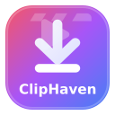
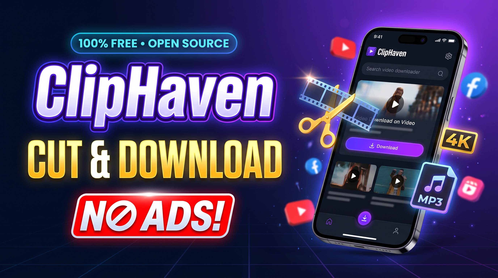

<div align="center">

#  ClipHaven

**Catch, keep, and enjoy your clips — locally, safely, and effortlessly.**


[](https://github.com/AsadullahAlMunib/ClipHaven/releases/tag/v3.3.1)
[](https://www.npmjs.com/package/@asadullahalmunib/cliphaven)
[](https://pypi.org/project/cliphaven/)


[](https://github.com/AsadullahAlMunib)
[](LICENSE)

[](README_BN.md)

[📖 Documentation](https://asadullahalmunib.github.io/ClipHaven/) • [✨ Features](#-key-features) • [⚡ Quick Downloads](#-quick-downloads) • [🚀 Getting Started](#-getting-started) • [❓ FAQ](#-faq--troubleshooting) • [📦 Releases](https://github.com/AsadullahAlMunib/ClipHaven/releases) • [👨‍💻 Developer](#-developer)

<br />

<a href="https://asadullahalmunib.github.io/ClipHaven/">
  
</a>
  
<sub>▶️ <strong>Click the thumbnail</strong> to explore the <a href="https://asadullahalmunib.github.io/ClipHaven/">Official Interactive Documentation</a> or watch the <a href="https://www.facebook.com/reel/2985920465079076/">English Walkthrough Video</a>.</sub>

<br />

ClipHaven is a modern, high-speed, 100% local video and audio downloader developed by [**Md Asadullah Al Munib**](https://github.com/AsadullahAlMunib) and powered by [`yt-dlp`](https://github.com/yt-dlp/yt-dlp) and `FFmpeg`. Available across **Windows, macOS, Linux (`x64` & `ARM64`), and Android (`64-bit` & `32-bit`)**, it runs privately on your device (`127.0.0.1:8765`) — **no ads, no tracking, no external server relays, and zero telemetry**.

</div>

<details>
<summary align="center"><h3>✨ Click here to view all ClipHaven features at a glance (Dropdown)</h3></summary>

- **🌐 Supported Platforms:** YouTube, Meta (Facebook, Instagram, Threads), LinkedIn (`linkedin.com` & `lnkd.in`), TikTok, X / Twitter (`t.co`), Reddit (`redd.it`), Vimeo, Dailymotion (`dai.ly`), Twitch, Pinterest (`pin.it`), SoundCloud (`snd.sc`)
- **🎯 Video Resolutions:** Best Available, 2160p (4K), 1440p (2K), 1080p (Full HD), 720p (HD), 480p, 360p (Data Saver)
- **🎬 Video Formats:** MP4, MKV, WEBM
- **🎵 Audio Formats:** MP3, M4A, WAV
- **💻📱 Supported OS:** Windows, macOS, Linux (`x64` & `ARM64`), Android (`64-bit` & `32-bit`)
- **📦 Official npm & PyPI CLI:** Launch from any terminal via `npx @asadullahalmunib/cliphaven` (hybrid Python `.venv` → cached Release binary fallback) or `pipx run cliphaven`, with `<URL>` direct launch, `--port`, `--no-browser`, `--doctor`, `--update`, and interactive `Y/Yes/Yas` & `N/No` update prompts
- **🎨 Bilingual Studio UI (`EN / বাংলা`):** Clean, 100% offline Deep Slate + Teal interface with instant English/Bangla switching, Light/Dark modes, sliding `Video / Audio` tabs, quick format & resolution chips, drag-and-drop URL paste, and auto-detected icons for all 13 platforms
- **📋 Sequential Download Queue (`Download Next` / `Up Next`):** Queue additional videos while one is downloading; queued links run sequentially 1-at-a-time automatically
- **✂️ Visual Clip Trimmer & Cutter:** Interactive dual-handle timeline slider with floating time bubbles, `Reset`, max-duration clamping guard, manual `Start`/`End` inputs, live FFmpeg progress, and exact container duration
- **⚡ High-Speed Adaptive Engine:** `--http-chunk-size 10M` anti-throttling, `--concurrent-fragments 6` parallel DASH/HLS downloads with automatic 4-thread fallback on HTTP 429 rate limits, tuned `--buffer-size`, and automatic Desktop `aria2c` acceleration when installed
- **💬 Multi-Language Subtitles (CC):** Original native spoken language captions (`.*-orig`, YouTube-style CC) & manual captions (Bangla, English, etc.), automatically trimmed and time-shifted to stay synced with cut clips
- **🖼️ Cover Art Embedding:** Permanent video thumbnail embedding (`MP4`, `MKV`, `MP3`, `M4A`) via `mutagen`
- **📑 Unlimited Progressive Playlist Downloader:** Auto-default full playlist mode, unlimited progressive video selector dropdown (no 100-video cap) with live playlist search, zero-selection guard, 500ms smooth `DocumentFragment` batch rendering, smart range compression (`1-50,52-500`), auto-stop background preview on download, and live playlist counter
- **🔍 Instant Link Preview:** Sub-second metadata loading via lightweight `oEmbed` (~0.2s), 64-entry LRU cache, non-blocking background duration resolution & instant client-side thumbnail rendering on paste
- **🤖 Android Background Service & Rich Notifications:** Uninterrupted screen-off downloads powered by Android Foreground Service (`dataSync`) & `WakeLock`, 1:1 center-cropped square thumbnail preview, custom `logo.svg` status bar silhouette, silent active channel + separate completion sound channel, `EN / বাংলা` language sync, and **`▶️ Play`**, **`📂 Open Folder`**, and **`✕ Cancel`** actions
- **🔄 Play Protect-Safe In-App Auto-Updates:** In-app GitHub release checker using Android's native `DownloadManager` with versioned APK naming, automatic old-APK cleanup, and update notifications on Desktop
- **📲 Android Share Support:** Direct one-click download via Android **"Share to ClipHaven"** menu
- **📁 Custom Save Folder & Clean Filenames:** Direct native OS & Android device SAF folder picker (`Browse`) with persistent Scoped Storage permissions and clean video filenames (without trailing `[video_id]` brackets)
- **📊 Live Progress & Controls:** Real-time `%`, downloaded size, speed (`MB/s`), `ETA`, instant cancellation, and post-download **`📂 Open Folder`** navigation
- **🔒 100% Local & Private:** Runs locally on device with zero ads, zero tracking, bundled FFmpeg, and zero telemetry
</details>

<br />

## ⚡ Quick Downloads

> 💡 **Latest Release: [`v3.3.1`](https://github.com/AsadullahAlMunib/ClipHaven/releases/tag/v3.3.1)** — Want interactive download cards, live release notes, and video walkthroughs? Visit the [**Official Documentation**](https://asadullahalmunib.github.io/ClipHaven/#downloads).

<details open>
  <summary><strong>📥 Click here to choose &amp; download ClipHaven <code>v3.3.1</code> for your device (Dropdown Menu)</strong></summary>
  <br />

  * **🪟 Windows:**
    * ⭐ [**`ClipHaven-Windows-All.zip`**](https://github.com/AsadullahAlMunib/ClipHaven/releases/download/v3.3.1/ClipHaven-Windows-All.zip) — *Full Windows Bundle with `FFmpeg` & all dependencies included (Recommended)*
    * 📦 [**`ClipHaven-Windows.exe`**](https://github.com/AsadullahAlMunib/ClipHaven/releases/download/v3.3.1/ClipHaven-Windows.exe) — *Standalone single-file portable Windows executable*
  * **🐧 Linux (x64 &amp; ARM64):**
    * ⭐ [**`ClipHaven-Linux-x64-All.zip`**](https://github.com/AsadullahAlMunib/ClipHaven/releases/download/v3.3.1/ClipHaven-Linux-x64-All.zip) — *Full Linux x64 Bundle with `FFmpeg` & all dependencies included*
    * 📦 [**`ClipHaven-Linux-x64`**](https://github.com/AsadullahAlMunib/ClipHaven/releases/download/v3.3.1/ClipHaven-Linux-x64) — *Standalone single-file Linux x64 binary*
    * ⭐ [**`ClipHaven-Linux-ARM64-All.zip`**](https://github.com/AsadullahAlMunib/ClipHaven/releases/download/v3.3.1/ClipHaven-Linux-ARM64-All.zip) — *Full Linux ARM64 Bundle with `FFmpeg` & all dependencies included*
    * 📦 [**`ClipHaven-Linux-ARM64`**](https://github.com/AsadullahAlMunib/ClipHaven/releases/download/v3.3.1/ClipHaven-Linux-ARM64) — *Standalone single-file Linux ARM64 binary*
  * **🍎 macOS:**
    * ⭐ [**`ClipHaven-macOS-All.zip`**](https://github.com/AsadullahAlMunib/ClipHaven/releases/download/v3.3.1/ClipHaven-macOS-All.zip) — *Full macOS Bundle with `FFmpeg` & all dependencies included*
    * 📦 [**`ClipHaven-macOS`**](https://github.com/AsadullahAlMunib/ClipHaven/releases/download/v3.3.1/ClipHaven-macOS) — *Standalone single-file macOS binary*
  * **🤖 Android (64-bit &amp; 32-bit):**
    * ⭐ [**`ClipHaven-Android-64bit.apk`**](https://github.com/AsadullahAlMunib/ClipHaven/releases/download/v3.3.1/ClipHaven-Android-64bit.apk) — *For modern 64-bit Android phones (`arm64-v8a`, Recommended)*
    * 📱 [**`ClipHaven-Android-32bit.apk`**](https://github.com/AsadullahAlMunib/ClipHaven/releases/download/v3.3.1/ClipHaven-Android-32bit.apk) — *For older 32-bit Android phones &amp; TV boxes (`armeabi-v7a`)*
  * **⚡ Source Code + Launcher (`.bat`):**
    * 🛠️ [**`ClipHaven-Source-Bat.zip`**](https://github.com/AsadullahAlMunib/ClipHaven/releases/download/v3.3.1/ClipHaven-Source-Bat.zip) — *Lightweight source bundle with one-click `setup-and-run.bat`*
</details>

<br />

| Platform | All-in-One Bundle (`-All.zip`) ⭐ | Standalone Single App |
| :--- | :--- | :--- |
| **🪟 Windows** | [⬇️ `ClipHaven-Windows-All.zip`](https://github.com/AsadullahAlMunib/ClipHaven/releases/download/v3.3.1/ClipHaven-Windows-All.zip) | [⬇️ `ClipHaven-Windows.exe`](https://github.com/AsadullahAlMunib/ClipHaven/releases/download/v3.3.1/ClipHaven-Windows.exe) |
| **🍎 macOS** | [⬇️ `ClipHaven-macOS-All.zip`](https://github.com/AsadullahAlMunib/ClipHaven/releases/download/v3.3.1/ClipHaven-macOS-All.zip) | [⬇️ `ClipHaven-macOS`](https://github.com/AsadullahAlMunib/ClipHaven/releases/download/v3.3.1/ClipHaven-macOS) |
| **🐧 Linux (x64)** | [⬇️ `ClipHaven-Linux-x64-All.zip`](https://github.com/AsadullahAlMunib/ClipHaven/releases/download/v3.3.1/ClipHaven-Linux-x64-All.zip) | [⬇️ `ClipHaven-Linux-x64`](https://github.com/AsadullahAlMunib/ClipHaven/releases/download/v3.3.1/ClipHaven-Linux-x64) |
| **🐧 Linux (ARM64)** | [⬇️ `ClipHaven-Linux-ARM64-All.zip`](https://github.com/AsadullahAlMunib/ClipHaven/releases/download/v3.3.1/ClipHaven-Linux-ARM64-All.zip) | [⬇️ `ClipHaven-Linux-ARM64`](https://github.com/AsadullahAlMunib/ClipHaven/releases/download/v3.3.1/ClipHaven-Linux-ARM64) |
| **🤖 Android (64-bit)** | *(Self-contained inside `.apk`)* | [⬇️ `ClipHaven-Android-64bit.apk`](https://github.com/AsadullahAlMunib/ClipHaven/releases/download/v3.3.1/ClipHaven-Android-64bit.apk) |
| **🤖 Android (32-bit)** | *(Self-contained inside `.apk`)* | [⬇️ `ClipHaven-Android-32bit.apk`](https://github.com/AsadullahAlMunib/ClipHaven/releases/download/v3.3.1/ClipHaven-Android-32bit.apk) |
| **⚡ Source + `.bat`** | [⬇️ `ClipHaven-Source-Bat.zip`](https://github.com/AsadullahAlMunib/ClipHaven/releases/download/v3.3.1/ClipHaven-Source-Bat.zip) | [📦 All Releases](https://github.com/AsadullahAlMunib/ClipHaven/releases/latest) |
| **📦 npm CLI** | `npx @asadullahalmunib/cliphaven` | [🌐 npm Package](https://www.npmjs.com/package/@asadullahalmunib/cliphaven) |
| **🐍 PyPI CLI** | `pipx run cliphaven` | [🌐 PyPI Package](https://pypi.org/project/cliphaven/) |

<br />

## ✨ Key Features

### 💻 Multi-Platform Ready
* **Desktop (`-All.zip` & Standalone Binaries):** Full pre-packaged bundles and portable single-file apps for **Windows, macOS, Linux x64, and Linux ARM64** with `FFmpeg` pre-included.
* **Android (`ClipHaven-Android-64bit.apk` & `ClipHaven-Android-32bit.apk`):** Lightweight, architecture-specific `.apk` builds powered by `youtubedl-android` with Foreground Service (`dataSync`) & `WakeLock` for uninterrupted screen-off downloads, rich notifications (`▶️ Play`, `📂 Open Folder`, `✕ Cancel`), incremental playlist export, network retry resilience, Play Protect-safe `DownloadManager` updates (with versioned APK naming & old-APK auto-cleanup), and zero-setup local execution saving directly to `Downloads/ClipHaven`.
* **Source Launcher (`setup-and-run.bat`):** Creates an isolated `.venv`, installs/updates `yt-dlp`, `imageio-ffmpeg`, and `mutagen`, and launches the dashboard automatically.

### 🌐 Wide Multi-Platform Extraction
Cleanly extracts video and audio from popular media platforms:
* **YouTube:** Full Videos, Shorts, and complete Playlists (unlimited size)
* **Meta:** Facebook Videos & Reels, Instagram Reels, Posts & Threads (`threads.net` & `threads.com`)
* **Others:** LinkedIn (`linkedin.com` & `lnkd.in`), TikTok, X / Twitter (including `t.co` share links), Reddit (`redd.it`), Vimeo, Dailymotion (`dai.ly`), Twitch, Pinterest (`pin.it`), and SoundCloud (`snd.sc`)

### 🎯 Precision Tools & Media Options
* **🎨 Bilingual Studio UI (`EN / বাংলা`) & Smart Queue:** Switch between English and Bangla instantly, toggle Light/Dark themes, drag-and-drop video URLs, and queue extra videos using **`Download Next`** (`Up Next` runs sequentially 1-at-a-time).
* **⚡ Adaptive Speed Engine:** Uses `--http-chunk-size 10M` to bypass YouTube stream throttling, `--concurrent-fragments 6` with automatic safe fallback to 4 threads on HTTP 429 rate limits, tuned `--buffer-size`, and automatic `aria2c` acceleration on Desktop when available in `PATH`.
* **📁 Native Folder Picker (`Browse`):** Pick your download folder using your OS's native folder selection dialog (or Android's direct SAF picker, including SD cards) or type any path directly.
* **🔍 Instant ~0.2s Link Preview & Auto-Stop:** Displays thumbnail, title, and channel almost instantaneously via lightweight `oEmbed` + 64-entry LRU cache, resolves exact duration asynchronously in the background, and automatically cancels running background playlist previews the moment a download starts.
* **✂️ Visual Clip Trimmer & Cutter with Live Progress:** Trim specific time ranges using the interactive dual-handle timeline slider (with floating time bubbles, `Reset`, and max-duration guard) or manual `MM:SS` / `HH:MM:SS` inputs, with real-time FFmpeg percentage (`%`), encoding speed, remaining `ETA`, exact container duration, and automatically trimmed/time-shifted subtitles.
* **📑 Unlimited Progressive Playlist Downloads:** Removes the 100-video cap to stream playlists of any size (100, 500, 2,000+ videos) in smooth 500ms `DocumentFragment` batches with live playlist search, interactive checkboxes, zero-selection validation, smart range compression (`1-50,52-500`), and a live visual badge (`📑 3/15 • 2 done • 12 left`).
* **💬 Multi-Language Subtitles (CC):** Automatically detects and embeds the video's exact original spoken language caption (`.*-orig`, just like YouTube's CC button) alongside manual Bangla (`bn`) and English (`en`) subtitles while skipping robotic auto-translations (`skip=translated_subs`).
* **🖼️ Embed Cover Art / Thumbnail & Clean Filenames:** Embeds video thumbnails as permanent cover art into `MP4`, `MKV`, `MP3`, and `M4A` files via `mutagen`, and saves clean titles without trailing `[video_id]` brackets.
* **⚡ Multiple Formats & 4K Quality:**
  * **Video Formats:** `MP4` *(Recommended)*, `MKV`, `WEBM`
  * **Audio Formats:** `MP3`, `M4A`, `WAV`
  * **Resolutions:** `Best Available`, `4K (2160p)`, `2K (1440p)`, `1080p`, `720p`, `480p`, `360p (Data Saver)`
* **📊 Real-Time Feedback:** Live download speed counters (`MB/s`), downloaded size metrics, accurate remaining time (`ETA`), percentage progress bars, instant cancellation, and post-download directory navigation (`📂 Open Folder`).

<br />

## 🚀 Getting Started

> 📖 Prefer an interactive visual guide? Check out the [**Official Setup Guide**](https://asadullahalmunib.github.io/ClipHaven/#install).

### Method 1: All-in-One Bundles (`-All.zip` — ⭐ Recommended for Desktop)
1. Download `ClipHaven-Windows-All.zip`, `ClipHaven-macOS-All.zip`, `ClipHaven-Linux-x64-All.zip`, or `ClipHaven-Linux-ARM64-All.zip` from [Release `v3.3.1`](https://github.com/AsadullahAlMunib/ClipHaven/releases/tag/v3.3.1).
2. Extract the archive and launch **`ClipHaven`** (`ClipHaven.exe` on Windows). Your browser will open `http://127.0.0.1:8765/`.


### Method 2: Android App (`ClipHaven-Android-64bit.apk` / `ClipHaven-Android-32bit.apk`)
1. Download [`ClipHaven-Android-64bit.apk`](https://github.com/AsadullahAlMunib/ClipHaven/releases/download/v3.3.1/ClipHaven-Android-64bit.apk) *(for modern 64-bit phones)* or [`ClipHaven-Android-32bit.apk`](https://github.com/AsadullahAlMunib/ClipHaven/releases/download/v3.3.1/ClipHaven-Android-32bit.apk) *(for older 32-bit devices)* and install it.
2. Open **ClipHaven** (or share any video link directly to ClipHaven from YouTube, Facebook, Instagram, LinkedIn, or TikTok).


### Method 3: Run via npm (`npx`) or PyPI (`pipx`)
#### Run directly without global install (requires Node.js 18+)
```bash
npx @asadullahalmunib/cliphaven
```
*Or install globally and launch from anywhere*
```bash
npm install -g @asadullahalmunib/cliphaven
```
*Launch directly with a video link*
```bash
cliphaven https://www.youtube.com/watch?v=cW4ZbT-JCPI
```
*Upgrade yt-dlp / cached binary*
```bash
cliphaven --update
```

#### Or run directly via Python PyPI / pipx (Python 3.10+)
```bash
pipx run cliphaven
```
*Or install via pip*
```bash
pip install cliphaven && cliphaven
```

*Both CLIs support `<URL>` direct launch, `--port`, `--no-browser`, `--doctor`, `--update`, and a 4-hour cached `Y/Yes/Yas` & `N/No` update notifier (`--no-update-check` to skip). The npm CLI automatically uses Python 3.10+ (`~/.cliphaven/venv`) when available and falls back to the cached GitHub Release binary otherwise.*


### Method 4: One-Click Script (`setup-and-run.bat`)
1. Ensure **Python 3.10+** is installed with **"Add Python to PATH"** enabled.
2. Download and extract [`ClipHaven-Source-Bat.zip`](https://github.com/AsadullahAlMunib/ClipHaven/releases/download/v3.3.1/ClipHaven-Source-Bat.zip) (or clone the repository):
   ```bash
   git clone https://github.com/AsadullahAlMunib/ClipHaven.git
   cd ClipHaven
   ```
3. Double-click **`setup-and-run.bat`**. The script manages virtual environment creation, installs `yt-dlp`, portable `FFmpeg` (`imageio-ffmpeg`), and `mutagen`, and opens the dashboard automatically.

### Method 5: Developer Setup (macOS / Linux / Windows)
```bash
# 1. Create and activate a virtual environment
python3 -m venv .venv
source .venv/bin/activate       # On Windows: .venv\Scripts\activate

# 2. Install dependencies (includes yt-dlp, imageio-ffmpeg, and mutagen)
pip install --upgrade pip
pip install -r requirements.txt pytest

# 3. Launch server
python server.py

# 4. (Optional) Run tests locally
pytest -v
```

<br />

## ❓ FAQ & Troubleshooting

<details>
<summary><strong>Windows Defender / SmartScreen shows a warning on first launch</strong></summary>

ClipHaven is an open-source, unsigned community build. Always download **`ClipHaven-Windows-All.zip`** (which avoids single-file temp-unpacking antivirus heuristics). If SmartScreen prompts, click **More info → Run anyway**, or run directly from source using `setup-and-run.bat`.
</details>

<details>
<summary><strong>Do embedded subtitles stay in sync when I cut a specific clip?</strong></summary>

Yes. ClipHaven automatically trims `.vtt`/`.srt` cues to your `[Start Time, End Time]` window and shifts all timestamps back to `00:00`, ensuring subtitles stay synced and the output file matches the exact clipped duration.
</details>

<details>
<summary><strong>Where are downloaded files saved on Android?</strong></summary>

By default, files are saved directly to `Downloads/ClipHaven` and indexed immediately for your Gallery and Music apps. You can choose any custom folder (including SD cards) using the **`📁 Browse`** button.
</details>

See more answers in the [**Full Documentation FAQ**](https://asadullahalmunib.github.io/ClipHaven/#faq).

<br />

## 📂 Project Structure

```
ClipHaven/
├── .github/
│   ├── dependabot.yml                                             # Weekly dependency update configuration
│   └── workflows/
│       ├── ci.yml                                                 # Multi-OS Python tests, Ruff lint, npm CLI & Android CI
│       ├── npm-publish.yml                                        # Auto-publish @asadullahalmunib/cliphaven on GitHub Release
│       ├── pypi-publish.yml                                       # Auto-publish cliphaven to PyPI on GitHub Release
│       └── release.yml                                            # Automated 11-asset release builder (Desktop, Android & Source)
├── android/                                                       # Self-contained Android APK project (Kotlin + youtubedl-android)
│   ├── build.gradle.kts                                           # Root Android Gradle plugin configuration
│   ├── gradle.properties                                          # Gradle JVM memory & AndroidX build flags
│   ├── settings.gradle.kts                                        # Gradle repositories & module includes
│   └── app/
│       ├── build.gradle.kts                                       # App dependencies, 64/32-bit ABI splits & web asset sync
│       ├── proguard-rules.pro                                     # ProGuard/R8 keep rules for WebView JS bridge
│       └── src/main/
│           ├── AndroidManifest.xml                                # Permissions, singleTask launchMode, Share intents & services
│           ├── java/com/asadullahalmunib/cliphaven/
│           │   ├── DownloadForegroundService.kt                   # Foreground dataSync service, WakeLock & rich notifications
│           │   ├── FormatUtils.kt                                 # URL validation, semver/tag filter & playlist range compression
│           │   ├── MainActivity.kt                                # WebViewAssetLoader UI, JS bridge, SAF picker & yt-dlp engine
│           │   ├── PlaylistHelper.kt                              # Direct playlist Page-1 & InnerTube continuation pagination
│           │   └── SubtitleSyncHelper.kt                          # Trimmed clip .vtt/.srt subtitle slicing & time-shifting
│           └── res/
│               ├── drawable/
│               │   ├── ic_stat_cliphaven.xml                      # Monochrome status bar notification icon
│               │   └── notif_progress_drawable.xml                  # Thick rounded Teal-Emerald-Amber notification progress bar
│               ├── layout/
│               │   └── notification_download_progress.xml         # 3-line DecoratedCustomViewStyle progress layout
│               └── xml/
│                   └── file_paths.xml                             # FileProvider storage paths for direct notification Play
├── bin/
│   └── cliphaven.js                                               # Hybrid npm/npx CLI launcher (Python .venv -> Release binary)
├── core/                                                          # Modular Python backend helpers
│   ├── __init__.py                                                # Core Python package initializer
│   ├── playlist.py                                                # Direct playlist Page-1 & InnerTube continuation pagination
│   └── subtitles.py                                               # Trimmed clip .vtt/.srt cue slicing & time-shifting
├── docs/
│   └── index.html                                                 # Official bilingual interactive documentation (GitHub Pages)
├── scripts/
│   └── generate_icons.py                                          # Vector logo.svg -> logo.ico & Android mipmap icon generator
├── tests/
│   └── test_server.py                                             # Automated unit & API integration test suite
├── .gitignore                                                     # Git ignore rules for caches, venvs & build artifacts
├── CHANGELOG.md                                                   # Detailed record of updates and version history
├── LICENSE                                                        # MIT Open Source License
├── MANIFEST.in                                                    # PyPI source distribution asset include rules
├── README.md                                                      # English documentation
├── README_BN.md                                                   # Bangla documentation
├── app.js                                                         # Client state, Up Next queue, clip slider, sound/haptics & polling
├── index.html                                                     # Bilingual EN/বাংলা Studio UI markup
├── logo.svg                                                       # Vector application logo and favicon
├── package.json                                                   # npm package (@asadullahalmunib/cliphaven), bin & dev scripts
├── pyproject.toml                                                 # Project metadata & Ruff/pytest configuration
├── requirements.txt                                               # Core Python dependencies (yt-dlp, imageio-ffmpeg, mutagen)
├── server.py                                                      # Local HTTP server, fast previews & yt-dlp / FFmpeg backend
├── setup-and-run.bat                                              # Windows one-click environment builder & launcher
└── style.css                                                      # Deep Slate + Teal theme tokens & GPU micro-animations
```

<br />

## 👨‍💻 Developer

* **Developer:** [Md Asadullah Al Munib](https://github.com/AsadullahAlMunib)
* **Official Documentation:** [https://asadullahalmunib.github.io/ClipHaven/](https://asadullahalmunib.github.io/ClipHaven/)
* **Official Repository:** [https://github.com/AsadullahAlMunib/ClipHaven/](https://github.com/AsadullahAlMunib/ClipHaven/)

<br />

## 🤝 Contributing & Feedback

Contributions, suggestions, and bug reports are welcome!
* 🐛 **Found a bug?** Open an [Issue](https://github.com/AsadullahAlMunib/ClipHaven/issues).
* 💡 **Have a feature idea?** Start a discussion or submit a [Pull Request](https://github.com/AsadullahAlMunib/ClipHaven/pulls).
* 📜 **Want to see what changed?** Check out the [CHANGELOG.md](CHANGELOG.md) or review the [Latest Release Notes](https://github.com/AsadullahAlMunib/ClipHaven/releases/latest).

<br />

## 📄 License

This project is licensed under the [MIT License](LICENSE) — Copyright (c) 2026 **Md Asadullah Al Munib**.