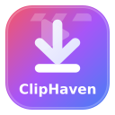

<div align="center">

#  ClipHaven

**আপনার ক্লিপ ধরুন, সংরক্ষণ করুন আর উপভোগ করুন — লোকালি, নিরাপদে ও অনায়াসে।**


[](https://github.com/AsadullahAlMunib/ClipHaven/releases/tag/tv3.2.2)


[](https://github.com/AsadullahAlMunib)
[](LICENSE)

[](README.md)

[✨ ফিচারসমূহ](#features) • [⚡ দ্রুত ডাউনলোড](#quick-downloads) • [🚀 শুরু করার নির্দেশিকা](#getting-started) • [📦 রিলিজ](https://github.com/AsadullahAlMunib/ClipHaven/releases) • [👨‍💻 ডেভেলপার](#developer)

ClipHaven একটি আধুনিক, দ্রুতগতির ও ১০০% লোকাল ভিডিও এবং অডিও ডাউনলোডার, যা [**Md Asadullah Al Munib**](https://github.com/AsadullahAlMunib) ডেভেলপ করেছেন এবং [`yt-dlp`](https://github.com/yt-dlp/yt-dlp) দ্বারা চালিত। এটি **Windows, macOS, Linux (`x64` ও `ARM64`) এবং Android (`64-bit` ও `32-bit`)**-এ পাওয়া যায় এবং আপনার ডিভাইসেই ব্যক্তিগতভাবে (`127.0.0.1:8765`) চলে — **কোনো বিজ্ঞাপন নেই, কোনো ট্র্যাকিং নেই, বাইরের কোনো সার্ভার রিলে নেই এবং শূন্য টেলিমেট্রি**।
</div>


<details>
<summary align="center"><h3>✨ ClipHaven-এর সব ফিচার এক নজরে দেখতে এখানে ক্লিক করুন (ড্রপডাউন)</h3></summary>
<br />

- **🌐 সমর্থিত প্ল্যাটফর্ম:** YouTube, Meta (Facebook, Instagram, Threads), LinkedIn, TikTok, X / Twitter, Reddit, Vimeo, Dailymotion, Twitch, Pinterest, SoundCloud
- **🎯 ভিডিও রেজোলিউশন:** Best Available (প্রস্তাবিত), 2160p (4K), 1440p (2K), 1080p (Full HD), 720p (HD), 480p, 360p
- **🎬 ভিডিও ফরম্যাট:** MP4, MKV, WEBM
- **🎵 অডিও ফরম্যাট:** MP3, M4A, WAV
- **💻📱 সমর্থিত OS:** Windows, macOS, Linux (x64 ও ARM64), Android (64-bit ও 32-bit)
- **✂️ ভিডিও ক্লিপ কাটার:** ভিডিও/অডিওর নির্দিষ্ট অংশ (Start Time – End Time) `-preset ultrafast` দিয়ে কেটে নিন
- **💬 বহুভাষিক সাবটাইটেল (CC):** ভিডিওর মূল কথ্য ভাষার ক্যাপশন (`.*-orig`, YouTube-স্টাইল CC) ও ম্যানুয়াল ক্যাপশন (বাংলা, ইংরেজি ইত্যাদি), ট্রিম করা ক্লিপের সাথে সিঙ্ক করা
- **🖼️ কভার আর্ট এমবেডিং:** ভিডিওর থাম্বনেইল স্থায়ীভাবে এমবেড করা (MP4, MKV, MP3, M4A)
- **📑 প্লেলিস্ট ডাউনলোডার:** ডিফল্টভাবে পুরো প্লেলিস্ট মোড, ৫টি আইটেমের স্ক্রলযোগ্য ভিডিও সিলেক্টর ড্রপডাউন (`--playlist-items`) ও লাইভ প্লেলিস্ট কাউন্টার
- **🔍 ইনস্ট্যান্ট লিংক প্রিভিউ:** হালকা `oEmbed`-এর মাধ্যমে সাব-সেকেন্ড মেটাডেটা লোডিং (~0.2 সেকেন্ড) এবং পেস্ট করার সাথে সাথে ক্লায়েন্ট-সাইডে থাম্বনেইল রেন্ডারিং
- **🤖 Android ব্যাকগ্রাউন্ড সার্ভিস:** Android Foreground Service (`dataSync`), `WakeLock` ও স্ট্যাটাস বার প্রোগ্রেসের সাহায্যে স্ক্রিন বন্ধ থাকলেও নিরবচ্ছিন্ন ডাউনলোড
- **🔄 ইন-অ্যাপ অটো-আপডেট:** অ্যাপের ভেতরেই রিলিজ চেকার — Android-এ সরাসরি APK অটো-ইনস্টলার এবং ডেস্কটপে আপডেট নোটিফিকেশন
- **📲 Android Share সাপোর্ট:** Android-এর "Share to ClipHaven" মেনু থেকে এক ক্লিকেই ডাউনলোড
- **📁 কাস্টম সেভ ফোল্ডার:** নেটিভ OS ও Android ডিভাইসের ফোল্ডার পিকার (`Browse`) এবং স্থায়ী Scoped Storage পারমিশন
- **📊 লাইভ প্রোগ্রেস ও কন্ট্রোল:** রিয়েল-টাইম %, স্পিড (MB/s), ETA এবং তাৎক্ষণিক ক্যানসেল
- **🔒 ১০০% লোকাল ও প্রাইভেট:** আপনার ডিভাইসেই চলে — বিজ্ঞাপন নেই, ট্র্যাকিং নেই, FFmpeg বান্ডেল করা এবং শূন্য টেলিমেট্রি
</details>

<br />

<a id="quick-downloads"></a>

## ⚡ দ্রুত ডাউনলোড

<details open>
  <summary><strong>📥 আপনার ডিভাইসের জন্য ClipHaven বেছে নিয়ে ডাউনলোড করতে এখানে ক্লিক করুন (ড্রপডাউন মেনু)</strong></summary>
  <br />

  * **🪟 Windows:**
    * ⭐ [**`ClipHaven-Windows-All.zip`**](https://github.com/AsadullahAlMunib/ClipHaven/releases/download/tv3.2.2/ClipHaven-Windows-All.zip) — *`FFmpeg` ও সব ডিপেন্ডেন্সিসহ সম্পূর্ণ Windows বান্ডেল (প্রস্তাবিত)*
    * 📦 [**`ClipHaven-Windows.exe`**](https://github.com/AsadullahAlMunib/ClipHaven/releases/download/tv3.2.2/ClipHaven-Windows.exe) — *স্ট্যান্ডঅ্যালোন সিঙ্গেল-ফাইল পোর্টেবল Windows এক্সিকিউটেবল*
  * **🐧 Linux (x64 ও ARM64):**
    * ⭐ [**`ClipHaven-Linux-x64-All.zip`**](https://github.com/AsadullahAlMunib/ClipHaven/releases/download/tv3.2.2/ClipHaven-Linux-x64-All.zip) — *`FFmpeg` ও সব ডিপেন্ডেন্সিসহ সম্পূর্ণ Linux x64 বান্ডেল*
    * 📦 [**`ClipHaven-Linux-x64`**](https://github.com/AsadullahAlMunib/ClipHaven/releases/download/tv3.2.2/ClipHaven-Linux-x64) — *স্ট্যান্ডঅ্যালোন সিঙ্গেল-ফাইল Linux x64 বাইনারি*
    * ⭐ [**`ClipHaven-Linux-ARM64-All.zip`**](https://github.com/AsadullahAlMunib/ClipHaven/releases/download/tv3.2.2/ClipHaven-Linux-ARM64-All.zip) — *`FFmpeg` ও সব ডিপেন্ডেন্সিসহ সম্পূর্ণ Linux ARM64 বান্ডেল*
    * 📦 [**`ClipHaven-Linux-ARM64`**](https://github.com/AsadullahAlMunib/ClipHaven/releases/download/tv3.2.2/ClipHaven-Linux-ARM64) — *স্ট্যান্ডঅ্যালোন সিঙ্গেল-ফাইল Linux ARM64 বাইনারি*
  * **🍎 macOS:**
    * ⭐ [**`ClipHaven-macOS-All.zip`**](https://github.com/AsadullahAlMunib/ClipHaven/releases/download/tv3.2.2/ClipHaven-macOS-All.zip) — *`FFmpeg` ও সব ডিপেন্ডেন্সিসহ সম্পূর্ণ macOS বান্ডেল*
    * 📦 [**`ClipHaven-macOS`**](https://github.com/AsadullahAlMunib/ClipHaven/releases/download/tv3.2.2/ClipHaven-macOS) — *স্ট্যান্ডঅ্যালোন সিঙ্গেল-ফাইল macOS বাইনারি*
  * **🤖 Android (64-bit ও 32-bit):**
    * ⭐ [**`ClipHaven-Android-64bit.apk`**](https://github.com/AsadullahAlMunib/ClipHaven/releases/download/tv3.2.2/ClipHaven-Android-64bit.apk) — *আধুনিক 64-bit Android ফোনের জন্য (`arm64-v8a`, প্রস্তাবিত)*
    * 📱 [**`ClipHaven-Android-32bit.apk`**](https://github.com/AsadullahAlMunib/ClipHaven/releases/download/tv3.2.2/ClipHaven-Android-32bit.apk) — *পুরনো 32-bit Android ফোন ও TV বক্সের জন্য (`armeabi-v7a`)*
  * **⚡ সোর্স কোড + লঞ্চার (`.bat`):**
    * 🛠️ [**`ClipHaven-Source-Bat.zip`**](https://github.com/AsadullahAlMunib/ClipHaven/releases/download/tv3.2.2/ClipHaven-Source-Bat.zip) — *এক-ক্লিকে `setup-and-run.bat` সহ হালকা সোর্স বান্ডেল*
</details>

<br />

| প্ল্যাটফর্ম | অল-ইন-ওয়ান বান্ডেল (`-All.zip`) ⭐ | স্ট্যান্ডঅ্যালোন সিঙ্গেল অ্যাপ |
| :--- | :--- | :--- |
| **🪟 Windows** | [⬇️ `ClipHaven-Windows-All.zip`](https://github.com/AsadullahAlMunib/ClipHaven/releases/download/tv3.2.2/ClipHaven-Windows-All.zip) | [⬇️ `ClipHaven-Windows.exe`](https://github.com/AsadullahAlMunib/ClipHaven/releases/download/tv3.2.2/ClipHaven-Windows.exe) |
| **🍎 macOS** | [⬇️ `ClipHaven-macOS-All.zip`](https://github.com/AsadullahAlMunib/ClipHaven/releases/download/tv3.2.2/ClipHaven-macOS-All.zip) | [⬇️ `ClipHaven-macOS`](https://github.com/AsadullahAlMunib/ClipHaven/releases/download/tv3.2.2/ClipHaven-macOS) |
| **🐧 Linux (x64)** | [⬇️ `ClipHaven-Linux-x64-All.zip`](https://github.com/AsadullahAlMunib/ClipHaven/releases/download/tv3.2.2/ClipHaven-Linux-x64-All.zip) | [⬇️ `ClipHaven-Linux-x64`](https://github.com/AsadullahAlMunib/ClipHaven/releases/download/tv3.2.2/ClipHaven-Linux-x64) |
| **🐧 Linux (ARM64)** | [⬇️ `ClipHaven-Linux-ARM64-All.zip`](https://github.com/AsadullahAlMunib/ClipHaven/releases/download/tv3.2.2/ClipHaven-Linux-ARM64-All.zip) | [⬇️ `ClipHaven-Linux-ARM64`](https://github.com/AsadullahAlMunib/ClipHaven/releases/download/tv3.2.2/ClipHaven-Linux-ARM64) |
| **🤖 Android (64-bit)** | *(`.apk`-এর ভেতরেই সম্পূর্ণ)* | [⬇️ `ClipHaven-Android-64bit.apk`](https://github.com/AsadullahAlMunib/ClipHaven/releases/download/tv3.2.2/ClipHaven-Android-64bit.apk) *(প্রস্তাবিত)* |
| **🤖 Android (32-bit)** | *(`.apk`-এর ভেতরেই সম্পূর্ণ)* | [⬇️ `ClipHaven-Android-32bit.apk`](https://github.com/AsadullahAlMunib/ClipHaven/releases/download/tv3.2.2/ClipHaven-Android-32bit.apk) |
| **⚡ সোর্স + `.bat`** | [⬇️ `ClipHaven-Source-Bat.zip`](https://github.com/AsadullahAlMunib/ClipHaven/releases/download/tv3.2.2/ClipHaven-Source-Bat.zip) | [📦 সব রিলিজ](https://github.com/AsadullahAlMunib/ClipHaven/releases/latest) |


<a id="features"></a>

## ✨ প্রধান ফিচারসমূহ

### 💻 মাল্টি-প্ল্যাটফর্ম রেডি
* **ডেস্কটপ (`-All.zip` ও স্ট্যান্ডঅ্যালোন বাইনারি):** **Windows, macOS, Linux x64 ও Linux ARM64**-এর জন্য `FFmpeg` আগে থেকেই অন্তর্ভুক্ত সম্পূর্ণ প্রি-প্যাকেজড বান্ডেল এবং পোর্টেবল সিঙ্গেল-ফাইল অ্যাপ।
* **Android (`ClipHaven-Android-64bit.apk` ও `ClipHaven-Android-32bit.apk`):** হালকা, আর্কিটেকচার-নির্দিষ্ট `.apk` বিল্ড — Foreground Service ও WakeLock-সহ নিরবচ্ছিন্ন ব্যাকগ্রাউন্ড ডাউনলোড, ইনক্রিমেন্টাল প্লেলিস্ট এক্সপোর্ট, নেটওয়ার্ক রিট্রাই রেজিলিয়েন্স এবং কোনো সেটআপ ছাড়াই লোকালি চলে সরাসরি `Downloads/ClipHaven`-এ সেভ করে।
* **সোর্স লঞ্চার (`setup-and-run.bat`):** আলাদা `.venv` তৈরি করে, `yt-dlp` ও `imageio-ffmpeg` ইনস্টল/আপডেট করে এবং ড্যাশবোর্ড চালু করে।

### 🌐 বহু প্ল্যাটফর্ম থেকে এক্সট্র্যাকশন
জনপ্রিয় মিডিয়া প্ল্যাটফর্ম থেকে পরিষ্কারভাবে ভিডিও ও অডিও এক্সট্র্যাক্ট করে:
* **YouTube:** পূর্ণ ভিডিও, Shorts এবং সম্পূর্ণ প্লেলিস্ট
* **Meta:** Facebook ভিডিও ও Reels, Instagram Reels, পোস্ট ও Threads (`threads.net` ও `threads.com`)
* **অন্যান্য:** LinkedIn (`linkedin.com` ও `lnkd.in`), TikTok, X / Twitter (`t.co` শেয়ার লিংকসহ), Reddit, Vimeo, Dailymotion, Twitch, Pinterest (`pin.it`) এবং SoundCloud (`snd.sc`)

### 🎯 নিখুঁত টুলস ও মিডিয়া অপশন
* **📁 নেটিভ ফোল্ডার পিকার (`Browse`):** আপনার OS-এর নেটিভ ফোল্ডার সিলেকশন ডায়ালগ দিয়ে ডাউনলোড ফোল্ডার বেছে নিন, অথবা সরাসরি যেকোনো পাথ টাইপ করুন।
* **✂️ লাইভ প্রোগ্রেসসহ ভিডিও ট্রিমিং ও ক্লিপ কাটার:** নির্দিষ্ট সময়সীমা (`Start Time` থেকে `End Time`, `MM:SS` বা `HH:MM:SS` ফরম্যাটে) ডাউনলোড করুন, সাথে রিয়েল-টাইম FFmpeg শতকরা হার (`%`), এনকোডিং স্পিড ও বাকি সময় (`ETA`) দেখুন।
* **📑 প্লেলিস্ট ডাউনলোড:** পুরো ভিডিও প্লেলিস্ট ব্যাচে ডাউনলোড করুন। ভিজ্যুয়াল ব্যাজ (`📑 3/15 • 2 done • 12 left`) দেখাবে প্লেলিস্টের কোন ভিডিওটি ডাউনলোড হচ্ছে, কয়টি শেষ হয়েছে এবং কয়টি বাকি আছে।
* **💬 বহুভাষিক সাবটাইটেল (CC):** ভিডিওর হুবহু মূল কথ্য ভাষার ক্যাপশন (`.*-orig`, ঠিক YouTube-এর CC বাটনের মতো) স্বয়ংক্রিয়ভাবে শনাক্ত করে এমবেড করে, সাথে ম্যানুয়াল বাংলা (`bn`) ও ইংরেজি (`en`) সাবটাইটেলও; রোবটিক অটো-ট্রান্সলেশন বাদ দেয় (`skip=translated_subs`)।
* **🖼️ কভার আর্ট / থাম্বনেইল এমবেড:** `MP4`, `MKV`, `MP3` ও `M4A` ফাইলে ভিডিওর থাম্বনেইল স্থায়ী কভার আর্ট হিসেবে এমবেড করে।
* **⚡ একাধিক ফরম্যাট ও 4K কোয়ালিটি:**
  * **ভিডিও ফরম্যাট:** `MP4` *(প্রস্তাবিত)*, `MKV`, `WEBM`
  * **অডিও ফরম্যাট:** `MP3`, `M4A`, `WAV`
  * **রেজোলিউশন:** `Best Available`, `4K (2160p)`, `2K (1440p)`, `1080p`, `720p`, `480p`, `360p`
* **📊 রিয়েল-টাইম ফিডব্যাক:** লাইভ ডাউনলোড স্পিড কাউন্টার (`MB/s`), নির্ভুল বাকি সময় (`ETA`), শতকরা প্রোগ্রেস বার এবং ডাউনলোড শেষে ডিরেক্টরি নেভিগেশন (`📂 Open Folder`)।


<a id="getting-started"></a>

## 🚀 শুরু করার নির্দেশিকা

### পদ্ধতি ১: অল-ইন-ওয়ান বান্ডেল (`-All.zip` — ⭐ ডেস্কটপের জন্য প্রস্তাবিত)
1. [Releases](https://github.com/AsadullahAlMunib/ClipHaven/releases/latest) থেকে `ClipHaven-Windows-All.zip`, `ClipHaven-macOS-All.zip`, `ClipHaven-Linux-x64-All.zip` অথবা `ClipHaven-Linux-ARM64-All.zip` ডাউনলোড করুন।
2. আর্কাইভটি এক্সট্র্যাক্ট করে **`ClipHaven`** চালু করুন (Windows-এ `ClipHaven.exe`)। আপনার ব্রাউজারে `http://127.0.0.1:8765/` খুলবে।

### পদ্ধতি ২: Android অ্যাপ (`ClipHaven-Android-64bit.apk` / `ClipHaven-Android-32bit.apk`)
1. [`ClipHaven-Android-64bit.apk`](https://github.com/AsadullahAlMunib/ClipHaven/releases/download/tv3.2.2/ClipHaven-Android-64bit.apk) *(আধুনিক 64-bit ফোনের জন্য)* অথবা [`ClipHaven-Android-32bit.apk`](https://github.com/AsadullahAlMunib/ClipHaven/releases/download/tv3.2.2/ClipHaven-Android-32bit.apk) *(পুরনো 32-bit ডিভাইসের জন্য)* ডাউনলোড করে ইনস্টল করুন।
2. **ClipHaven** খুলুন (অথবা YouTube, Facebook, Instagram, LinkedIn বা TikTok থেকে যেকোনো ভিডিও লিংক সরাসরি ClipHaven-এ শেয়ার করুন)।

### পদ্ধতি ৩: এক-ক্লিক স্ক্রিপ্ট (`setup-and-run.bat`)
1. **Python 3.10+** ইনস্টল করা আছে এবং **"Add Python to PATH"** চালু রাখা হয়েছে কি না নিশ্চিত করুন।
2. [`ClipHaven-Source-Bat.zip`](https://github.com/AsadullahAlMunib/ClipHaven/releases/download/tv3.2.2/ClipHaven-Source-Bat.zip) ডাউনলোড করে এক্সট্র্যাক্ট করুন (অথবা রিপোজিটরি ক্লোন করুন):
   ```bash
   git clone https://github.com/AsadullahAlMunib/ClipHaven.git
   cd ClipHaven
   ```
3. **`setup-and-run.bat`** ডাবল-ক্লিক করুন। স্ক্রিপ্টটি ভার্চুয়াল এনভায়রনমেন্ট তৈরি করে, `yt-dlp` ও পোর্টেবল `FFmpeg` (`imageio-ffmpeg`) ইনস্টল করে এবং স্বয়ংক্রিয়ভাবে ড্যাশবোর্ড খোলে।

### পদ্ধতি ৪: ডেভেলপার সেটআপ (macOS / Linux / Windows)
```bash
# 1. Create and activate a virtual environment
python3 -m venv .venv
source .venv/bin/activate       # On Windows: .venv\Scripts\activate

# 2. Install dependencies (includes yt-dlp, imageio-ffmpeg, and mutagen)
pip install --upgrade pip
pip install -r requirements.txt pytest

# 3. Launch server
python server.py

# 4. (Optional) Run tests locally
pytest -v
```


## 📂 প্রজেক্টের কাঠামো

```
ClipHaven/
├── .github/
│   ├── dependabot.yml            # ডিপেন্ডেন্সি আপডেটারের কনফিগারেশন
│   └── workflows/
│       ├── ci.yml                # মাল্টি-প্ল্যাটফর্ম CI টেস্টিং পাইপলাইন
│       └── release.yml           # স্বয়ংক্রিয় ১১-অ্যাসেট বিল্ডার (Windows, macOS, Linux x64/ARM64, Android 64/32-bit ও সোর্স)
├── android/                      # স্বয়ংসম্পূর্ণ Android APK প্রজেক্ট (WebView + youtubedl-android)
├── scripts/
│   └── generate_icons.py         # logo.svg থেকে logo.ico ও Android mipmap জেনারেটর
├── tests/
│   └── test_server.py            # ইউনিট ও API ইন্টিগ্রেশন টেস্ট স্যুট
├── logo.svg                      # ভেক্টর অ্যাপ লোগো ও ফেভিকন
├── index.html                    # পরিচ্ছন্ন, রেসপন্সিভ ওয়েব UI
├── style.css                     # ডার্ক ও লাইট মোডের ডিজাইন টোকেন ও অ্যানিমেশন
├── app.js                        # ক্লায়েন্ট স্টেট, প্রিভিউ রেন্ডারিং, ফোল্ডার পিকার ও পোলিং
├── server.py                     # লোকাল HTTP সার্ভার ও yt-dlp ব্যাকএন্ড ব্রিজ
├── setup-and-run.bat             # Windows এক-ক্লিক রানার ও এনভায়রনমেন্ট বিল্ডার
├── requirements.txt              # মূল Python ডিপেন্ডেন্সি (yt-dlp + imageio-ffmpeg + mutagen)
├── pyproject.toml                # প্রজেক্ট কনফিগারেশন ও মেটাডেটা
├── CHANGELOG.md                  # আপডেট ও ভার্সন পরিবর্তনের বিস্তারিত রেকর্ড
└── LICENSE                       # MIT ওপেন সোর্স লাইসেন্স
```


<a id="developer"></a>

## 👨‍💻 ডেভেলপার

* **ডেভেলপার:** [Md Asadullah Al Munib](https://github.com/AsadullahAlMunib)
* **অফিশিয়াল রিপোজিটরি:** [https://github.com/AsadullahAlMunib/ClipHaven/](https://github.com/AsadullahAlMunib/ClipHaven/)


## 🤝 অবদান ও মতামত

অবদান, পরামর্শ ও বাগ রিপোর্ট সবসময়ই স্বাগত!
* 🐛 **বাগ পেয়েছেন?** একটি [Issue](https://github.com/AsadullahAlMunib/ClipHaven/issues) খুলুন।
* 💡 **নতুন ফিচারের আইডিয়া আছে?** আলোচনা শুরু করুন অথবা একটি [Pull Request](https://github.com/AsadullahAlMunib/ClipHaven/pulls) জমা দিন।
* 📜 **কী কী বদলেছে জানতে চান?** [CHANGELOG.md](CHANGELOG.md) দেখুন অথবা [সর্বশেষ রিলিজ নোট](https://github.com/AsadullahAlMunib/ClipHaven/releases/latest) পড়ুন।


## 📄 লাইসেন্স

এই প্রজেক্টটি [MIT লাইসেন্স](LICENSE)-এর অধীনে লাইসেন্সপ্রাপ্ত — Copyright (c) 2026 **Md Asadullah Al Munib**।