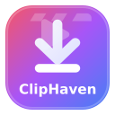
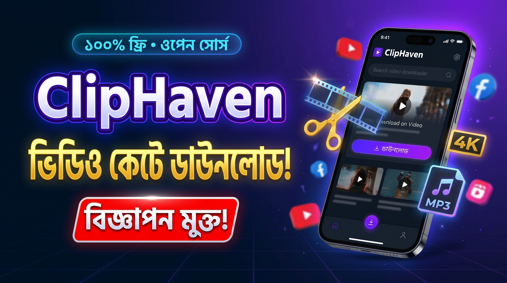

<div align="center">

#  ClipHaven

**আপনার ক্লিপ কেটে নিন, সংরক্ষণ করুন আর উপভোগ করুন — লোকালি, নিরাপদে ও অনায়াসে।**


[](https://github.com/AsadullahAlMunib/ClipHaven/releases/tag/v3.3.0)


[](https://github.com/AsadullahAlMunib)
[](LICENSE)

[](README.md)

[📖 ডকুমেন্টেশন](https://asadullahalmunib.github.io/ClipHaven/) • [✨ ফিচারসমূহ](#features) • [⚡ দ্রুত ডাউনলোড](#quick-downloads) • [🚀 শুরু করার নির্দেশিকা](#getting-started) • [❓ FAQ](#faq) • [📦 রিলিজ](https://github.com/AsadullahAlMunib/ClipHaven/releases) • [👨‍💻 ডেভেলপার](#developer)

<br />

<a href="https://asadullahalmunib.github.io/ClipHaven/">
  
</a>

<sub>▶️ <strong>থাম্বনেইলে ক্লিক করুন</strong> — <a href="https://asadullahalmunib.github.io/ClipHaven/">অফিশিয়াল ইন্টারঅ্যাক্টিভ ডকুমেন্টেশন</a> দেখতে অথবা <a href="https://www.youtube.com/watch?v=cW4ZbT-JCPI">ভিডিও ওয়াকথ্রু</a> দেখতে।</sub>

<br />

ClipHaven একটি আধুনিক, দ্রুতগতির ও ১০০% লোকাল ভিডিও এবং অডিও ডাউনলোডার, যা [**Md Asadullah Al Munib**](https://github.com/AsadullahAlMunib) ডেভেলপ করেছেন এবং [`yt-dlp`](https://github.com/yt-dlp/yt-dlp) ও `FFmpeg` দ্বারা চালিত। এটি **Windows, macOS, Linux (`x64` ও `ARM64`) এবং Android (`64-bit` ও `32-bit`)**-এ পাওয়া যায় এবং আপনার ডিভাইসেই ব্যক্তিগতভাবে (`127.0.0.1:8765`) চলে — **কোনো বিজ্ঞাপন নেই, কোনো ট্র্যাকিং নেই, বাইরের কোনো সার্ভার রিলে নেই এবং শূন্য টেলিমেট্রি**।

</div>

<details>
<summary align="center"><h3>✨ ClipHaven-এর সব ফিচার এক নজরে দেখতে এখানে ক্লিক করুন (ড্রপডাউন)</h3></summary>

- **🌐 সমর্থিত প্ল্যাটফর্ম:** YouTube, Meta (Facebook, Instagram, Threads), LinkedIn (`linkedin.com` ও `lnkd.in`), TikTok, X / Twitter (`t.co`), Reddit (`redd.it`), Vimeo, Dailymotion (`dai.ly`), Twitch, Pinterest (`pin.it`), SoundCloud (`snd.sc`)
- **🎯 ভিডিও রেজোলিউশন:** Best Available, 2160p (4K), 1440p (2K), 1080p (Full HD), 720p (HD), 480p, 360p (Data Saver)
- **🎬 ভিডিও ফরম্যাট:** MP4, MKV, WEBM
- **🎵 অডিও ফরম্যাট:** MP3, M4A, WAV
- **💻📱 সমর্থিত OS:** Windows, macOS, Linux (`x64` ও `ARM64`), Android (`64-bit` ও `32-bit`)
- **🎨 দ্বিভাষিক স্টুডিও UI (`EN / বাংলা`):** ১০০% অফলাইন Deep Slate + Teal ইন্টারফেস, তাৎক্ষণিক ইংরেজি/বাংলা সুইচিং, লাইট/ডার্ক মোড, স্লাইডিং `Video / Audio` ট্যাব, কুইক ফরম্যাট ও রেজোলিউশন চিপস, ড্র্যাগ-অ্যান্ড-ড্রপ URL পেস্ট এবং ১৩টি প্ল্যাটফর্মের অটো আইকন
- **📋 ধারাবাহিক ডাউনলোড কিউ (`পরে ডাউনলোড করুন` / `পরবর্তী ডাউনলোড`):** একটি ভিডিও ডাউনলোড চলাকালীন নতুন লিংক যুক্ত করে রাখুন; সেগুলো একে একে স্বয়ংক্রিয়ভাবে ডাউনলোড হবে
- **✂️ ভিজ্যুয়াল ক্লিপ ট্রিমার ও কাটার:** ফ্লোটিং টাইম বাবলসহ ডুয়াল-হ্যান্ডেল টাইমলাইন স্লাইডার, `Reset` বাটন, ম্যাক্স-ডিউরেশন গার্ড, ম্যানুয়াল `Start`/`End` ইনপুট, লাইভ FFmpeg প্রগ্রেস এবং নির্ভুল ডিউরেশন
- **⚡ উচ্চ-গতির অ্যাডাপ্টিভ ইঞ্জিন:** YouTube থ্রটলিং এড়াতে `--http-chunk-size 10M`, `--concurrent-fragments 6` (HTTP 429 রেট লিমিট হলে স্বয়ংক্রিয়ভাবে ৪ থ্রেডে নিরাপদ রিট্রাই), অপটিমাইজড `--buffer-size` এবং ডেস্কটপে `aria2c` ইনস্টল থাকলে স্বয়ংক্রিয় মাল্টি-কানেকশন স্পিড বুস্ট
- **💬 বহুভাষিক সাবটাইটেল (CC):** ভিডিওর মূল কথ্য ভাষার ক্যাপশন (`.*-orig`, YouTube-স্টাইল CC) ও ম্যানুয়াল ক্যাপশন (বাংলা, ইংরেজি ইত্যাদি), যা কাটা ক্লিপের সাথে স্বয়ংক্রিয়ভাবে ট্রিম ও টাইম-শিফট হয়ে সিঙ্ক থাকে
- **🖼️ কভার আর্ট এমবেডিং:** `mutagen`-এর মাধ্যমে `MP4`, `MKV`, `MP3` ও `M4A` ফাইলে স্থায়ীভাবে ভিডিও থাম্বনেইল এমবেড করা
- **📑 আনলিমিটেড প্রোগ্রেসিভ প্লেলিস্ট ডাউনলোডার:** ডিফল্টভাবে সম্পূর্ণ প্লেলিস্ট মোড, ১০০-ভিডিওর সীমা ছাড়া আনলিমিটেড প্রোগ্রেসিভ ভিডিও সিলেক্টর ড্রপডাউন, লাইভ প্লেলিস্ট সার্চ, জিরো-সিলেকশন গার্ড, 500ms স্মুথ `DocumentFragment` ব্যাচ রেন্ডারিং, স্মার্ট রেঞ্জ কমপ্রেশন (`1-50,52-500`), ডাউনলোড শুরুতেই ব্যাকগ্রাউন্ড প্রিভিউ অটো-স্টপ এবং লাইভ প্লেলিস্ট কাউন্টার
- **🔍 তাৎক্ষণিক লিংক প্রিভিউ:** হালকা `oEmbed` (~0.2s) ও ৬৪-এন্ট্রি LRU ক্যাশের মাধ্যমে সাথে সাথেই মেটাডেটা লোড, ব্যাকগ্রাউন্ডে ডিউরেশন ফেচ এবং লিংক পেস্টের সাথে সাথেই ক্লায়েন্ট-সাইড থাম্বনেইল রেন্ডারিং
- **🤖 Android ব্যাকগ্রাউন্ড সার্ভিস ও রিচ নোটিফিকেশন:** Android Foreground Service (`dataSync`) ও `WakeLock`-এর মাধ্যমে স্ক্রিন বন্ধ থাকলেও নিরবচ্ছিন্ন ডাউনলোড, 1:1 স্কয়ার থাম্বনেইল প্রিভিউ, কাস্টম `logo.svg` স্ট্যাটাস বার আইকন, সাইলেন্ট অ্যাক্টিভ চ্যানেল + ডাউনলোড শেষে সাউন্ডসহ আলাদা নোটিফিকেশন, `EN / বাংলা` ভাষা সিঙ্ক এবং **`▶️ Play`**, **`📂 Open Folder`** ও **`✕ Cancel`** বাটন
- **🔄 Play Protect-সেফ ইন-অ্যাপ অটো-আপডেট:** Android-এর নেটিভ `DownloadManager` ব্যবহার করে ইন-অ্যাপ GitHub রিলিজ চেকার, ভার্সনযুক্ত APK নামকরণ, পুরনো APK স্বয়ংক্রিয় ক্লিনআপ এবং ডেস্কটপে আপডেট নোটিফিকেশন
- **📲 Android Share সাপোর্ট:** Android-এর **"Share to ClipHaven"** মেনু থেকে এক ক্লিকে সরাসরি ডাউনলোড
- **📁 কাস্টম সেভ ফোল্ডার ও পরিচ্ছন্ন ফাইলের নাম:** নেটিভ OS ও Android SAF ফোল্ডার পিকার (`Browse`) এবং শেষে `[video_id]` ব্র্যাকেট ছাড়া পরিচ্ছন্ন ফাইলের নাম
- **📊 লাইভ প্রগ্রেস ও কন্ট্রোল:** রিয়েল-টাইম `%`, ডাউনলোড হওয়া সাইজ, স্পিড (`MB/s`), `ETA`, তাৎক্ষণিক ক্যানসেল এবং ডাউনলোড শেষে **`📂 Open Folder`** নেভিগেশন
- **🔒 ১০০% লোকাল ও প্রাইভেট:** সম্পূর্ণ আপনার ডিভাইসে চলে — কোনো বিজ্ঞাপন, ট্র্যাকিং বা টেলিমেট্রি নেই এবং FFmpeg আগে থেকেই যুক্ত
</details>

<br />

<a id="quick-downloads"></a>
## ⚡ দ্রুত ডাউনলোড

> 💡 **লেটেস্ট রিলিজ: [`v3.3.0`](https://github.com/AsadullahAlMunib/ClipHaven/releases/tag/v3.3.0)** — ইন্টারঅ্যাক্টিভ ডাউনলোড কার্ড, লাইভ রিলিজ নোট এবং ভিডিও গাইড দেখতে ভিজিট করুন [**অফিশিয়াল ডকুমেন্টেশন**](https://asadullahalmunib.github.io/ClipHaven/#downloads)।

<details open>
  <summary><strong>📥 আপনার ডিভাইসের জন্য ClipHaven <code>v3.3.0</code> বেছে নিতে ও ডাউনলোড করতে এখানে ক্লিক করুন (ড্রপডাউন মেনু)</strong></summary>
  <br />

- **🪟 Windows:**
  - ⭐ [**`ClipHaven-Windows-All.zip`**](https://github.com/AsadullahAlMunib/ClipHaven/releases/download/v3.3.0/ClipHaven-Windows-All.zip) — *`FFmpeg` ও সব ডিপেন্ডেন্সিসহ সম্পূর্ণ Windows বান্ডেল (প্রস্তাবিত)*
  - 📦 [**`ClipHaven-Windows.exe`**](https://github.com/AsadullahAlMunib/ClipHaven/releases/download/v3.3.0/ClipHaven-Windows.exe) — *স্ট্যান্ডঅ্যালোন সিঙ্গেল-ফাইল পোর্টেবল Windows অ্যাপ*
- **🐧 Linux (x64 ও ARM64):**
  - ⭐ [**`ClipHaven-Linux-x64-All.zip`**](https://github.com/AsadullahAlMunib/ClipHaven/releases/download/v3.3.0/ClipHaven-Linux-x64-All.zip) — *`FFmpeg` ও সব ডিপেন্ডেন্সিসহ সম্পূর্ণ Linux x64 বান্ডেল*
  - 📦 [**`ClipHaven-Linux-x64`**](https://github.com/AsadullahAlMunib/ClipHaven/releases/download/v3.3.0/ClipHaven-Linux-x64) — *স্ট্যান্ডঅ্যালোন সিঙ্গেল-ফাইল Linux x64 বাইনারি*
  - ⭐ [**`ClipHaven-Linux-ARM64-All.zip`**](https://github.com/AsadullahAlMunib/ClipHaven/releases/download/v3.3.0/ClipHaven-Linux-ARM64-All.zip) — *`FFmpeg` ও সব ডিপেন্ডেন্সিসহ সম্পূর্ণ Linux ARM64 বান্ডেল*
  - 📦 [**`ClipHaven-Linux-ARM64`**](https://github.com/AsadullahAlMunib/ClipHaven/releases/download/v3.3.0/ClipHaven-Linux-ARM64) — *স্ট্যান্ডঅ্যালোন সিঙ্গেল-ফাইল Linux ARM64 বাইনারি*
- **🍎 macOS:**
  - ⭐ [**`ClipHaven-macOS-All.zip`**](https://github.com/AsadullahAlMunib/ClipHaven/releases/download/v3.3.0/ClipHaven-macOS-All.zip) — *`FFmpeg` ও সব ডিপেন্ডেন্সিসহ সম্পূর্ণ macOS বান্ডেল*
  - 📦 [**`ClipHaven-macOS`**](https://github.com/AsadullahAlMunib/ClipHaven/releases/download/v3.3.0/ClipHaven-macOS) — *স্ট্যান্ডঅ্যালোন সিঙ্গেল-ফাইল macOS বাইনারি*
- **🤖 Android (64-bit ও 32-bit):**
  - ⭐ [**`ClipHaven-Android-64bit.apk`**](https://github.com/AsadullahAlMunib/ClipHaven/releases/download/v3.3.0/ClipHaven-Android-64bit.apk) — *আধুনিক ৬৪-বিট Android ফোনের জন্য (`arm64-v8a`, প্রস্তাবিত)*
  - 📱 [**`ClipHaven-Android-32bit.apk`**](https://github.com/AsadullahAlMunib/ClipHaven/releases/download/v3.3.0/ClipHaven-Android-32bit.apk) — *পুরনো ৩২-বিট Android ফোন ও টিভি বক্সের জন্য (`armeabi-v7a`)*
- **⚡ সোর্স কোড + লঞ্চার (`.bat`):**
  - 🛠️ [**`ClipHaven-Source-Bat.zip`**](https://github.com/AsadullahAlMunib/ClipHaven/releases/download/v3.3.0/ClipHaven-Source-Bat.zip) — *এক-ক্লিকের `setup-and-run.bat` সহ হালকা সোর্স বান্ডেল*
</details>

<br />

| প্ল্যাটফর্ম | অল-ইন-ওয়ান বান্ডেল (`-All.zip`) ⭐ | স্ট্যান্ডঅ্যালোন সিঙ্গেল অ্যাপ |
| :--- | :--- | :--- |
| **🪟 Windows** | [⬇️ `ClipHaven-Windows-All.zip`](https://github.com/AsadullahAlMunib/ClipHaven/releases/download/v3.3.0/ClipHaven-Windows-All.zip) | [⬇️ `ClipHaven-Windows.exe`](https://github.com/AsadullahAlMunib/ClipHaven/releases/download/v3.3.0/ClipHaven-Windows.exe) |
| **🍎 macOS** | [⬇️ `ClipHaven-macOS-All.zip`](https://github.com/AsadullahAlMunib/ClipHaven/releases/download/v3.3.0/ClipHaven-macOS-All.zip) | [⬇️ `ClipHaven-macOS`](https://github.com/AsadullahAlMunib/ClipHaven/releases/download/v3.3.0/ClipHaven-macOS) |
| **🐧 Linux (x64)** | [⬇️ `ClipHaven-Linux-x64-All.zip`](https://github.com/AsadullahAlMunib/ClipHaven/releases/download/v3.3.0/ClipHaven-Linux-x64-All.zip) | [⬇️ `ClipHaven-Linux-x64`](https://github.com/AsadullahAlMunib/ClipHaven/releases/download/v3.3.0/ClipHaven-Linux-x64) |
| **🐧 Linux (ARM64)** | [⬇️ `ClipHaven-Linux-ARM64-All.zip`](https://github.com/AsadullahAlMunib/ClipHaven/releases/download/v3.3.0/ClipHaven-Linux-ARM64-All.zip) | [⬇️ `ClipHaven-Linux-ARM64`](https://github.com/AsadullahAlMunib/ClipHaven/releases/download/v3.3.0/ClipHaven-Linux-ARM64) |
| **🤖 Android (64-bit)** | *(সম্পূর্ণ `.apk`-এর ভেতরেই যুক্ত)* | [⬇️ `ClipHaven-Android-64bit.apk`](https://github.com/AsadullahAlMunib/ClipHaven/releases/download/v3.3.0/ClipHaven-Android-64bit.apk) |
| **🤖 Android (32-bit)** | *(সম্পূর্ণ `.apk`-এর ভেতরেই যুক্ত)* | [⬇️ `ClipHaven-Android-32bit.apk`](https://github.com/AsadullahAlMunib/ClipHaven/releases/download/v3.3.0/ClipHaven-Android-32bit.apk) |
| **⚡ সোর্স + `.bat`** | [⬇️ `ClipHaven-Source-Bat.zip`](https://github.com/AsadullahAlMunib/ClipHaven/releases/download/v3.3.0/ClipHaven-Source-Bat.zip) | [📦 সব রিলিজ](https://github.com/AsadullahAlMunib/ClipHaven/releases/latest) |

<br />

<a id="features"></a>
## ✨ প্রধান ফিচারসমূহ

### 💻 মাল্টি-প্ল্যাটফর্ম প্রস্তুত
- **ডেস্কটপ (`-All.zip` ও স্ট্যান্ডঅ্যালোন বাইনারি):** **Windows, macOS, Linux x64 এবং Linux ARM64**-এর জন্য `FFmpeg` আগে থেকেই যুক্ত সম্পূর্ণ প্রি-প্যাকেজড বান্ডেল ও পোর্টেবল সিঙ্গেল-ফাইল অ্যাপ।
- **Android (`ClipHaven-Android-64bit.apk` ও `ClipHaven-Android-32bit.apk`):** `youtubedl-android` চালিত হালকা ও আর্কিটেকচার-ভিত্তিক `.apk` বিল্ড। এতে আছে স্ক্রিন বন্ধ থাকলেও নিরবচ্ছিন্ন ডাউনলোডের জন্য Foreground Service (`dataSync`) ও `WakeLock`, রিচ নোটিফিকেশন (`▶️ Play`, `📂 Open Folder`, `✕ Cancel`), ইনক্রিমেন্টাল প্লেলিস্ট এক্সপোর্ট, নেটওয়ার্ক রিট্রাই সাপোর্ট, Play Protect-সেফ `DownloadManager` আপডেট (ভার্সনযুক্ত APK নামকরণ ও পুরনো APK অটো-ক্লিনআপসহ) এবং সরাসরি `Downloads/ClipHaven`-এ সেভ করার সুবিধা।
- **সোর্স লঞ্চার (`setup-and-run.bat`):** স্বয়ংক্রিয়ভাবে একটি আলাদা `.venv` তৈরি করে `yt-dlp`, `imageio-ffmpeg` ও `mutagen` ইনস্টল/আপডেট করে এবং ড্যাশবোর্ড চালু করে।

### 🌐 বিস্তৃত মাল্টি-প্ল্যাটফর্ম এক্সট্র্যাকশন
জনপ্রিয় সব মিডিয়া প্ল্যাটফর্ম থেকে নির্বিঘ্নে ভিডিও এবং অডিও ডাউনলোড করুন:
- **YouTube:** সম্পূর্ণ ভিডিও, Shorts এবং আনলিমিটেড সাইজের প্লেলিস্ট
- **Meta:** Facebook ভিডিও ও Reels, Instagram Reels, পোস্ট এবং Threads (`threads.net` ও `threads.com`)
- **অন্যান্য:** LinkedIn (`linkedin.com` ও `lnkd.in`), TikTok, X / Twitter (`t.co` শেয়ার লিংকসহ), Reddit (`redd.it`), Vimeo, Dailymotion (`dai.ly`), Twitch, Pinterest (`pin.it`) এবং SoundCloud (`snd.sc`)

### 🎯 নির্ভুল টুলস ও মিডিয়া অপশনসমূহ
- **🎨 দ্বিভাষিক স্টুডিও UI (`EN / বাংলা`) ও স্মার্ট কিউ:** তাৎক্ষণিকভাবে বাংলা ও ইংরেজি ভাষা এবং লাইট/ডার্ক থিম পরিবর্তন করুন, ড্র্যাগ-অ্যান্ড-ড্রপ করে লিংক দিন এবং **`পরে ডাউনলোড করুন`** (`Up Next`) দিয়ে একাধিক ভিডিও কিউতে সাজিয়ে একে একে ডাউনলোড করুন।
- **⚡ অ্যাডাপ্টিভ ডাউনলোড স্পিড ইঞ্জিন:** YouTube থ্রটলিং এড়াতে `--http-chunk-size 10M`, `--concurrent-fragments 6` (HTTP 429 রেট লিমিট হলে স্বয়ংক্রিয়ভাবে ৪ থ্রেডে নিরাপদ অটো-রিট্রাই), টিউন করা `--buffer-size` এবং ডেস্কটপে `aria2c` থাকলে স্বয়ংক্রিয় স্পিড বুস্ট।
- **📁 নেটিভ ফোল্ডার পিকার (`Browse`):** আপনার OS-এর নেটিভ ফোল্ডার সিলেক্টর ডায়ালগ (অথবা Android-এর ডিরেক্ট SAF পিকার, SD কার্ডসহ) দিয়ে ডাউনলোড ফোল্ডার বাছাই করুন অথবা সরাসরি পাথ লিখে দিন।
- **🔍 তাৎক্ষণিক ~0.2s লিংক প্রিভিউ ও অটো-স্টপ:** হালকা `oEmbed` এবং ৬৪-এন্ট্রি LRU ক্যাশের মাধ্যমে প্রায় সাথে সাথেই থাম্বনেইল, শিরোনাম ও চ্যানেলের নাম দেখায়, ব্যাকগ্রাউন্ডে সঠিক ডিউরেশন ফেচ করে এবং ডাউনলোড শুরু হওয়ার সাথে সাথেই চলমান ব্যাকগ্রাউন্ড প্লেলিস্ট প্রিভিউ স্বয়ংক্রিয়ভাবে বন্ধ করে দেয়।
- **✂️ ভিজ্যুয়াল ক্লিপ ট্রিমার ও লাইভ প্রগ্রেসসহ কাটার:** ইন্টারঅ্যাক্টিভ ডুয়াল-হ্যান্ডেল টাইমলাইন স্লাইডার (ফ্লোটিং টাইম বাবল, `Reset` ও ম্যাক্স-ডিউরেশন গার্ডসহ) অথবা ম্যানুয়াল `MM:SS` / `HH:MM:SS` দিয়ে নির্দিষ্ট অংশ কেটে ডাউনলোড করুন—সাথে থাকবে রিয়েল-টাইম FFmpeg `%`, এনকোডিং স্পিড, অবশিষ্ট `ETA`, সঠিক ডিউরেশন এবং স্বয়ংক্রিয়ভাবে সিঙ্ক হওয়া সাবটাইটেল।
- **📑 আনলিমিটেড প্রোগ্রেসিভ প্লেলিস্ট ডাউনলোড:** ১০০-ভিডিওর সীমা সরিয়ে যেকোনো বড় প্লেলিস্ট (১০০, ৫০০, ২,০০০+ ভিডিও) 500ms `DocumentFragment` ব্যাচে মসৃণভাবে লোড করে। লাইভ সার্চ ফিল্টার, ইন্টারঅ্যাক্টিভ চেকবক্স, জিরো-সিলেকশন ভ্যালিডেশন, স্মার্ট রেঞ্জ কমপ্রেশন (`1-50,52-500`) এবং লাইভ কাউন্টার ব্যাজ (`📑 3/15 • 2 done • 12 left`) যুক্ত রয়েছে।
- **💬 বহুভাষিক সাবটাইটেল (CC):** YouTube-এর CC বাটনের মতো ভিডিওর মূল কথ্য ভাষার ক্যাপশন (`.*-orig`) এবং ম্যানুয়াল বাংলা (`bn`) ও ইংরেজি (`en`) সাবটাইটেল স্বয়ংক্রিয়ভাবে শনাক্ত ও এমবেড করে, আর রোবটিক অটো-ট্রান্সলেশন বাদ দেয় (`skip=translated_subs`)।
- **🖼️ কভার আর্ট / থাম্বনেইল এমবেড ও পরিচ্ছন্ন ফাইলের নাম:** `mutagen`-এর মাধ্যমে `MP4`, `MKV`, `MP3` ও `M4A` ফাইলে স্থায়ী কভার আর্ট যুক্ত করে এবং শেষে `[video_id]` ব্র্যাকেট ছাড়া পরিচ্ছন্ন নামে ফাইল সেভ করে।
- **⚡ একাধিক ফরম্যাট ও 4K কোয়ালিটি:**
  - **ভিডিও ফরম্যাট:** `MP4` *(প্রস্তাবিত)*, `MKV`, `WEBM`
  - **অডিও ফরম্যাট:** `MP3`, `M4A`, `WAV`
  - **রেজোলিউশন:** `Best Available`, `4K (2160p)`, `2K (1440p)`, `1080p`, `720p`, `480p`, `360p (Data Saver)`
- **📊 রিয়েল-টাইম ফিডব্যাক:** লাইভ ডাউনলোড স্পিড (`MB/s`), ডাউনলোড হওয়া সাইজ, সঠিক অবশিষ্ট সময় (`ETA`), প্রগ্রেস বার, তাৎক্ষণিক ক্যানসেল এবং ডাউনলোড শেষে সরাসরি ফোল্ডার খোলার বাটন (`📂 Open Folder`)।

<br />

<a id="getting-started"></a>
## 🚀 শুরু করার নির্দেশিকা

> 📖 ইন্টারঅ্যাক্টিভ ভিজ্যুয়াল গাইড দেখতে চান? ঘুরে আসুন [**অফিশিয়াল সেটআপ গাইড**](https://asadullahalmunib.github.io/ClipHaven/#install) থেকে।

### পদ্ধতি ১: অল-ইন-ওয়ান বান্ডেল (`-All.zip` — ⭐ ডেস্কটপের জন্য প্রস্তাবিত)
1. [Release `v3.3.0`](https://github.com/AsadullahAlMunib/ClipHaven/releases/tag/v3.3.0) থেকে `ClipHaven-Windows-All.zip`, `ClipHaven-macOS-All.zip`, `ClipHaven-Linux-x64-All.zip`, অথবা `ClipHaven-Linux-ARM64-All.zip` ডাউনলোড করুন।
2. আর্কাইভটি এক্সট্র্যাক্ট করে **`ClipHaven`** (Windows-এ `ClipHaven.exe`) চালু করুন। আপনার ব্রাউজারে স্বয়ংক্রিয়ভাবে `http://127.0.0.1:8765/` খুলে যাবে।

### পদ্ধতি ২: Android অ্যাপ (`ClipHaven-Android-64bit.apk` / `ClipHaven-Android-32bit.apk`)
1. আধুনিক ৬৪-বিট ফোনের জন্য [`ClipHaven-Android-64bit.apk`](https://github.com/AsadullahAlMunib/ClipHaven/releases/download/v3.3.0/ClipHaven-Android-64bit.apk) অথবা পুরনো ৩২-বিট ডিভাইসের জন্য [`ClipHaven-Android-32bit.apk`](https://github.com/AsadullahAlMunib/ClipHaven/releases/download/v3.3.0/ClipHaven-Android-32bit.apk) ডাউনলোড করে ইনস্টল করুন।
2. **ClipHaven** ওপেন করুন (অথবা YouTube, Facebook, Instagram, LinkedIn বা TikTok থেকে যেকোনো ভিডিও লিংক সরাসরি ClipHaven-এ Share করুন)।

### পদ্ধতি ৩: এক-ক্লিক স্ক্রিপ্ট (`setup-and-run.bat`)
1. আপনার পিসিতে **"Add Python to PATH"** অপশনসহ **Python 3.10+** ইনস্টল করা আছে কি না নিশ্চিত করুন।
2. [`ClipHaven-Source-Bat.zip`](https://github.com/AsadullahAlMunib/ClipHaven/releases/download/v3.3.0/ClipHaven-Source-Bat.zip) ডাউনলোড ও এক্সট্র্যাক্ট করুন (অথবা রিপোজিটরি ক্লোন করুন):
   ```bash
   git clone https://github.com/AsadullahAlMunib/ClipHaven.git
   cd ClipHaven
   ```
3. **`setup-and-run.bat`** ফাইলে ডাবল-ক্লিক করুন। স্ক্রিপ্টটি নিজেই ভার্চুয়াল এনভায়রনমেন্ট তৈরি করবে, `yt-dlp`, পোর্টেবল `FFmpeg` (`imageio-ffmpeg`) ও `mutagen` ইনস্টল করবে এবং স্বয়ংক্রিয়ভাবে ড্যাশবোর্ড খুলে দেবে।

### পদ্ধতি ৪: ডেভেলপার সেটআপ (macOS / Linux / Windows)
```bash
# ১. ভার্চুয়াল এনভায়রনমেন্ট তৈরি ও অ্যাক্টিভেট করুন
python3 -m venv .venv
source .venv/bin/activate       # Windows-এ: .venv\Scripts\activate

# ২. ডিপেন্ডেন্সি ইনস্টল করুন (yt-dlp, imageio-ffmpeg এবং mutagen সহ)
pip install --upgrade pip
pip install -r requirements.txt pytest

# ৩. লোকাল সার্ভার চালু করুন
python server.py

# ৪. (ঐচ্ছিক) লোকালি টেস্ট রান করুন
pytest -v
```

<br />

<a id="faq"></a>
## ❓ সাধারণ প্রশ্নোত্তর ও সমাধান (FAQ)

<details>
<summary><strong>প্রথমবার চালু করার সময় Windows Defender / SmartScreen সতর্কতা দেখালে কী করবো?</strong></summary>

ClipHaven একটি ওপেন-সোর্স, আনসাইন্ড কমিউনিটি বিল্ড। ডেস্কটপে সবসময় **`ClipHaven-Windows-All.zip`** ডাউনলোড করুন (এতে সিঙ্গেল-ফাইল টেম্প-আনপ্যাকিং অ্যান্টিভাইরাস হিউরিস্টিক সমস্যা হয় না)। তবুও SmartScreen পপ-আপ এলে **More info → Run anyway** ক্লিক করুন, অথবা `setup-and-run.bat` দিয়ে সরাসরি সোর্স থেকে চালান।
</details>

<details>
<summary><strong>ভিডিওর নির্দিষ্ট অংশ কেটে ডাউনলোড করলে কি এমবেডেড সাবটাইটেল সিঙ্ক থাকে?</strong></summary>

হ্যাঁ। ClipHaven স্বয়ংক্রিয়ভাবে `.vtt`/`.srt` সাবটাইটেল কিউগুলো আপনার `[Start Time, End Time]` অনুযায়ী কেটে ফেলে এবং সব টাইমস্ট্যাম্প `00:00`-এ শিফট করে দেয়, ফলে সাবটাইটেল একদম সিঙ্ক থাকে এবং আউটপুট ফাইলের ডিউরেশনও নিখুঁত হয়।
</details>

<details>
<summary><strong>Android-এ ডাউনলোড করা ফাইলগুলো কোথায় সেভ হয়?</strong></summary>

ডিফল্টভাবে ফাইলগুলো সরাসরি `Downloads/ClipHaven` ফোল্ডারে সেভ হয় এবং সাথে সাথেই আপনার গ্যালারি ও মিউজিক অ্যাপে দেখা যায়। আপনি চাইলে **`📁 Browse`** বাটনে ট্যাপ করে SD কার্ডসহ যেকোনো কাস্টম ফোল্ডার বেছে নিতে পারবেন।
</details>

আরও প্রশ্নোত্তর দেখুন [**সম্পূর্ণ ডকুমেন্টেশন FAQ**](https://asadullahalmunib.github.io/ClipHaven/#faq)-এ।

<br />

## 📂 প্রজেক্ট স্ট্রাকচার

```
ClipHaven/
├── .github/
│   ├── dependabot.yml                                             # সাপ্তাহিক ডিপেন্ডেন্সি আপডেটার কনফিগারেশন
│   └── workflows/
│       ├── ci.yml                                                 # মাল্টি-OS Python টেস্ট, Ruff লিন্ট ও Android Gradle/lint CI
│       └── release.yml                                            # স্বয়ংক্রিয় ১১-অ্যাসেট রিলিজ বিল্ডার (Desktop, Android ও Source)
├── android/                                                       # স্বয়ংসম্পূর্ণ Android APK প্রজেক্ট (Kotlin + youtubedl-android)
│   ├── build.gradle.kts                                           # রুট Android Gradle প্লাগইন কনফিগারেশন
│   ├── gradle.properties                                          # Gradle JVM মেমরি ও AndroidX বিল্ড ফ্ল্যাগ
│   ├── settings.gradle.kts                                        # Gradle রিপোজিটরি ও মডিউল সেটিংস
│   └── app/
│       ├── build.gradle.kts                                       # অ্যাপ ডিপেন্ডেন্সি, 64/32-bit ABI স্প্লিট ও ওয়েব অ্যাসেট সিঙ্ক
│       ├── proguard-rules.pro                                     # WebView JS ব্রিজের জন্য ProGuard/R8 রুলস
│       └── src/main/
│           ├── AndroidManifest.xml                                # পারমিশন, singleTask মোড, Share ইন্টেন্ট ও সার্ভিস ডিক্লারেশন
│           ├── java/com/asadullahalmunib/cliphaven/
│           │   ├── DownloadForegroundService.kt                   # ব্যাকগ্রাউন্ড dataSync সার্ভিস, WakeLock ও রিচ নোটিফিকেশন
│           │   ├── FormatUtils.kt                                 # URL ভ্যালিডেশন, সেমভার/ট্যাগ ফিল্টার ও প্লেলিস্ট রেঞ্জ কমপ্রেশন
│           │   ├── MainActivity.kt                                # WebViewAssetLoader UI, JS ব্রিজ, SAF পিকার ও yt-dlp ইঞ্জিন
│           │   ├── PlaylistHelper.kt                              # সরাসরি প্লেলিস্ট পেজ-১ ও InnerTube কন্টিনিউয়েশন পেজিনেশন
│           │   └── SubtitleSyncHelper.kt                          # কাটা ক্লিপের .vtt/.srt সাবটাইটেল ট্রিমিং ও টাইম-শিফটিং
│           └── res/
│               ├── drawable/
│               │   └── ic_stat_cliphaven.xml                      # মনোক্রোম স্ট্যাটাস বার নোটিফিকেশন আইকন
│               ├── layout/
│               │   └── notification_download_progress.xml         # ৩-লাইনের DecoratedCustomViewStyle নোটিফিকেশন লেআউট
│               └── xml/
│                   └── file_paths.xml                             # নোটিফিকেশন থেকে সরাসরি Play-এর জন্য FileProvider পাথ
├── core/                                                          # মডুলার Python ব্যাকএন্ড হেল্পার প্যাকেজ
│   ├── __init__.py                                                # Core Python প্যাকেজ ইনিশিয়ালাইজার
│   ├── playlist.py                                                # সরাসরি প্লেলিস্ট পেজ-১ ও InnerTube কন্টিনিউয়েশন পেজিনেশন
│   └── subtitles.py                                               # কাটা ক্লিপের .vtt/.srt সাবটাইটেল ট্রিমিং ও টাইম-শিফটিং
├── docs/
│   └── index.html                                                 # অফিশিয়াল দ্বিভাষিক ইন্টারঅ্যাক্টিভ ডকুমেন্টেশন (GitHub Pages)
├── scripts/
│   └── generate_icons.py                                          # logo.svg থেকে logo.ico ও Android mipmap আইকন জেনারেটর
├── tests/
│   └── test_server.py                                             # স্বয়ংক্রিয় ইউনিট ও API ইন্টিগ্রেশন টেস্ট স্যুট
├── .gitignore                                                     # ক্যাশ, venv ও বিল্ড ফাইল বাদ দেওয়ার Git কনফিগ
├── CHANGELOG.md                                                   # সব আপডেট ও ভার্সন পরিবর্তনের বিস্তারিত রেকর্ড
├── LICENSE                                                        # MIT ওপেন-সোর্স লাইসেন্স
├── README.md                                                      # ইংরেজি ডকুমেন্টেশন
├── README_BN.md                                                   # বাংলা ডকুমেন্টেশন
├── app.js                                                         # ক্লায়েন্ট স্টেট, Up Next কিউ, ক্লিপ স্লাইডার, সাউন্ড/হ্যাপটিক ও পোলিং
├── index.html                                                     # দ্বিভাষিক EN/বাংলা স্টুডিও UI মার্কআপ
├── logo.svg                                                       # ভেক্টর অ্যাপ্লিকেশন লোগো ও ফ্যাভিকন
├── pyproject.toml                                                 # প্রজেক্ট মেটাডেটা ও Ruff/pytest কনফিগারেশন
├── requirements.txt                                               # মূল Python ডিপেন্ডেন্সি (yt-dlp, imageio-ffmpeg, mutagen)
├── server.py                                                      # লোকাল HTTP সার্ভার, ফাস্ট প্রিভিউ ও yt-dlp / FFmpeg ব্যাকএন্ড
├── setup-and-run.bat                                              # Windows এক-ক্লিক এনভায়রনমেন্ট বিল্ডার ও লঞ্চার
└── style.css                                                      # Deep Slate + Teal থিম টোকেন ও GPU মাইক্রো-অ্যানিমেশন
```

<br />

<a id="developer"></a>
## 👨‍💻 ডেভেলপার

- **ডেভেলপার:** [Md Asadullah Al Munib](https://github.com/AsadullahAlMunib)
- **অফিশিয়াল ডকুমেন্টেশন:** [https://asadullahalmunib.github.io/ClipHaven/](https://asadullahalmunib.github.io/ClipHaven/)
- **অফিশিয়াল রিপোজিটরি:** [https://github.com/AsadullahAlMunib/ClipHaven/](https://github.com/AsadullahAlMunib/ClipHaven/)

<br />

## 🤝 অবদান ও মতামত

যেকোনো অবদান, পরামর্শ এবং বাগ রিপোর্ট সাদরে গ্রহণ করা হয়!
- 🐛 **কোনো বাগ পেয়েছেন?** একটি [Issue](https://github.com/AsadullahAlMunib/ClipHaven/issues) ওপেন করুন।
- 💡 **নতুন কোনো ফিচার আইডিয়া আছে?** আলোচনা শুরু করুন অথবা একটি [Pull Request](https://github.com/AsadullahAlMunib/ClipHaven/pulls) সাবমিট করুন।
- 📜 **কী কী পরিবর্তন হয়েছে দেখতে চান?** [CHANGELOG.md](CHANGELOG.md) দেখুন অথবা [সর্বশেষ রিলিজ নোট](https://github.com/AsadullahAlMunib/ClipHaven/releases/latest) পড়ুন।

<br />

## 📄 লাইসেন্স

এই প্রজেক্টটি [MIT License](LICENSE)-এর অধীনে লাইসেন্সকৃত — কপিরাইট (c) ২০২৬ **Md Asadullah Al Munib**।